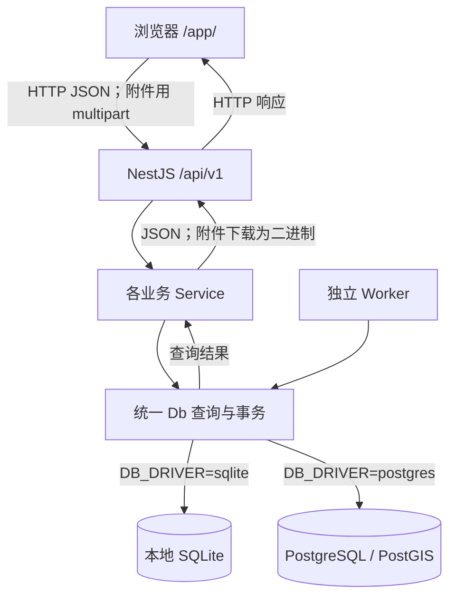
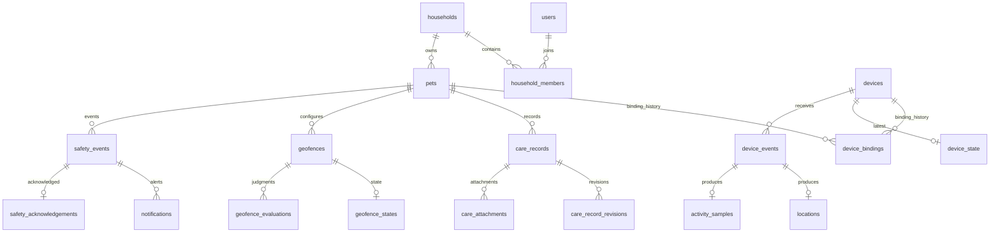
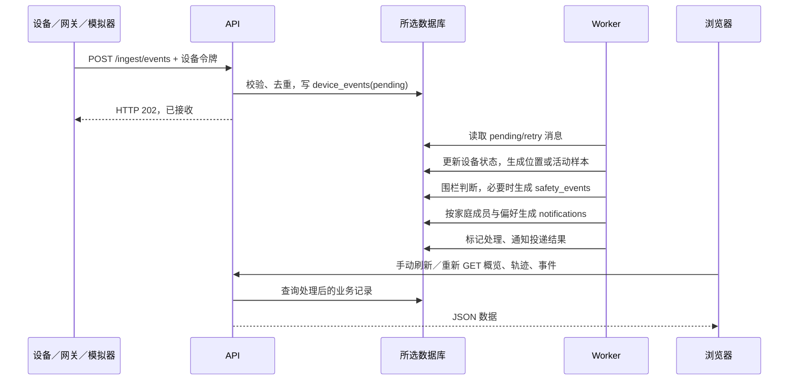
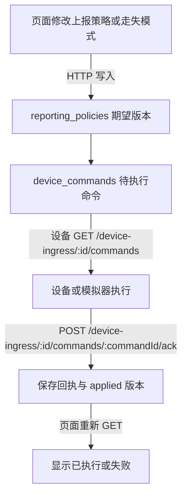

# 数据库结构与模块数据流

本文说明页面、接口、业务表与Worker的关系；具体运行路径由环境配置决定，不附原机器数据库位置或行数快照。

## 1. 当前数据库在哪里

| 环境 | 存储位置与选择方式 | 2026-11-17 检查结果 |
| --- | --- | --- |
| 普通 SQLite | 项目根目录 `data/doogy.db`，由 `.env` 的 `DB_PATH` 选择 | 当时 `.env` 为 SQLite/offline，41 张业务表，21 次迁移 |
| 独立演示 SQLite | 每次 `start-demo.bat` 生成 `data/mvp-demo-<随机标识>/doogy.db`，配套 `demo.env` | 独立演示库未纳入该次只读检查 |
| PostgreSQL | `.env.postgres` 的 `DATABASE_URL` 指向数据库服务，本地 Compose 将数据放在命名 volume `doogy-postgres` 中 | 当时的 `doogy` 库为 37 张业务表、2 次迁移 |

普通 SQLite 的实际绝对路径：

```text
./data/doogy.db
```

当前代码的目标模型是 **61 张业务表 + migrations 管理表**，最新迁移为 SQLite `034-contact-alerts.sql` 和 PostgreSQL `023-contact-alerts.sql`。第一批新增 `user_profiles/user_consents/user_onboarding/pet_avatars/pet_goals/body_check_ins`，接口、归属及保留见 [第一批后端联调](stage-01-backend.md)。第二批新增 `content_items/content_versions/learning_progress/health_observation_reads`，归属见 [第二批后端联调](stage-02-backend.md)。第三批增加 `pet_media/behavior_records/interpretations/assistant_conversations/assistant_messages`，共享行为与本人问答分别授权，见 [第三批后端联调](stage-03-backend.md)。后续新增 `pet_configuration_history/household_contacts`，分别按宠物和家庭共享授权，见 [配置历史与家庭联系人](configuration-contacts.md)；`password_recovery_requests` 保存短期验证散列与本人恢复元数据，见 [密码找回](password-recovery.md)；`contact_alerts/contact_alert_recipients` 保存文字请求及逐人模拟/失败结果，见 [联系人通知](contact-alerts.md)。`safety_events.closed_reason` 保存新关闭原因，旧记录仍为空。PostgreSQL 的 `spatial_ref_sys` 等 PostGIS 扩展对象未计入业务表。上方业务库行数保留原历史检查口径，不表示本次已升级用户库。

历史检查对 SQLite 使用只读连接和读取事务，对 PostgreSQL 使用 `REPEATABLE READ READ ONLY` 事务。检查期间业务库保持原有版本。拟升级的业务库以实际 `migrations` 记录为准，现有启动流程可在备份后应用增量迁移。[数据库操作说明](database-operations.md)

截至 2026-11-17 的检查时点，PostgreSQL 库记录止于 `002`。从该版本升级到当前模型需要依次应用 `003` 至 `023`，其中 `005`、`006` 和 `010` 增加了家庭保留、删除日志、库存保留和照护附件四张业务表，`013/014` 增加第一批六张业务表，`015/016` 增加第二批四张业务表，`017/018/019` 增加第三批五张业务表，`020/021` 增加配置历史和联系人，`022` 增加密码找回申请，`023` 增加通知请求和逐人结果；016另保存观察的内部插入顺序。实库回归在随机隔离库执行，不代表原业务库已升级。

一次启动只选择一个数据库；API 与 Worker 应使用同一份环境配置。SQLite 与 PostgreSQL **不会自动双写或互相同步**。迁移命令是从只读 SQLite 源向空 PostgreSQL 目标的一次性导入，不能用它覆盖已有非空目标。

## 2. 页面怎样连接数据库



图中的两个数据库是运行时二选一。前端不直接连接数据库，也不直接读取 `.db` 文件；`web/api.mjs` 的 `ApiClient` 默认访问同源 `/api/v1`。登录后请求携带 Bearer 令牌，服务检查家庭成员身份，再查询该家庭可见的宠物和数据。

当前 Web 采用**登录、切换标签、手动刷新或提交后重新请求**的方式更新画面，没有 WebSocket、SSE 或后台定时轮询。Worker 已处理新的设备数据时，停留中的页面需要刷新才能看到。

## 3. 页面、接口与表的对应关系

以下接口省略统一前缀 `/api/v1`；`:id` 等占位符应替换为实际 ID。

| 页面或模块 | 主要接口 | 主要业务表与传输方式 |
| --- | --- | --- |
| 登录、家庭 | `POST /auth/login`、`GET /auth/me`、`GET /households` | 查询 `users`，建立 `sessions`，按 `household_members` 返回家庭和角色 |
| 密码找回（新增API/CLI） | `POST /auth/password-recovery`、`POST /auth/password-reset`、本地recovery-deliver命令 | `password_recovery_requests` 只存token散列；成功后更改 `users.password_hash`、撤销 `sessions` 并写无秘密恢复日志 |
| 宠物档案 | `GET/POST /pets`、`PATCH /pets/:id` | JSON ↔ `pets`；`household_id` 确定归属 |
| 资料、引导、头像（新增API） | `PATCH /auth/me`、`GET/PATCH /auth/onboarding`、`PUT /pets/:id/avatar` | `user_profiles/user_consents/user_onboarding` 属本人；`pet_avatars` 按家庭授权读取当前正文 |
| 目标、身体观察与营养（新增API） | `/pets/:id/goals`、`body-check-ins`、`nutrition/daily`、`trends` | `pet_goals/body_check_ins` 按版本保存；营养和体重趋势重读有效 `care_records` |
| 课程与学习（新增API） | `/content`、`/lessons`、`/learning-progress`、`PUT /lessons/:id/progress` | 受控CLI写 `content_items/content_versions`；`learning_progress` 属本人，按课程版本保存 |
| 健康观察历史（新增API） | `/pets/:id/health-observations`、`/health-observations/:id`、`PATCH /health-observations/:id/read` | 复用完整日 `activity_observations` 证据；`health_observation_reads` 只记录本人知晓 |
| 媒体读取与删除（新增API） | `GET /pets/:id/media`、`GET /media/:id/content`、`DELETE /media/:id` | `pet_media` 保存元数据与唯一正文，授权读取支持Range；上传仍待确认限制 |
| 行为及解释任务（新增API） | `/pets/:id/behavior-records`、`POST/GET /pets/:id/interpretations`、`/interpretations/:id`、`POST /interpretations/:id/feedback` | 人工记录写 `behavior_records`，共享任务写 `interpretations`，分页历史读取摘要；反馈复用 `behavior_feedback`，绑定成功attempt并只保留最小来源引用。现有Worker固定演示或明确模型未配置失败 |
| 本人问答（新增API） | `/pets/:id/assistant-conversations`、`/assistant-conversations/:id/messages`、`/assistant-messages/:id` | `assistant_conversations/assistant_messages` 同时校验本人和当前宠物权限；来源失效清对应快照 |
| 配置历史（新增API） | `GET /pets/:id/configuration-history` | `pet_configuration_history` 保存围栏和策略请求前后配置、操作者及版本，按当前宠物权限读取 |
| 家庭联系人（新增API） | `GET/POST /households/:id/contacts`、`PATCH/DELETE /contacts/:id` | `household_contacts` 保存当前联系方式、主联系人及未经核验的成员报告同意；不发送通知 |
| 联系人通知（新增API） | `POST /pets/:id/contact-alerts`、`GET /contact-alerts/:id`、`retry/cancel` | `contact_alerts` 保存用户文字和本次操作者；`contact_alert_recipients` 保存版本化选择及逐人模拟/失败状态，不复制联系地址 |
| 概览 | `GET /pets/:id/overview` | 聚合档案、活动、照护、当前设备、位置、围栏、安全事件和本人通知；不是单独一张 overview 表 |
| 照护记录 | `POST /care-records`、`GET /pets/:id/care-records` | JSON ↔ `care_records`；修改历史存 `care_record_revisions`；体重记录影响宠物当前体重 |
| 附件上传、下载 | `POST /care-records/:id/attachments`、`GET /care-attachments/:id/content` | 上传 multipart → `care_attachments.content_base64`；下载时解码成图片/PDF 二进制响应 |
| 活动趋势 | `GET /pets/:id/activity/daily`、`weekly`、`observations/current` | `activity_samples` → 按日汇总缓存 `daily_summaries` → 规则观察；`activity_versions` 用于判断缓存是否过期 |
| 设备与绑定 | `POST /devices/claim`、`POST /devices/:id/unbind` | `devices`、`device_bindings`、`device_state`；保留绑定历史 |
| 上报策略、走失模式 | `PUT /devices/:id/reporting-policy`、`POST /devices/:id/lost-mode` | 期望策略写 `reporting_policies`，命令写 `device_commands`，走失时段写 `lost_mode_sessions`；等待设备回执 |
| 轨迹、事件 | `GET /pets/:id/locations`、`GET /pets/:id/safety-events`、`GET /safety-events/:id` | 分页读取 `locations`、`safety_events` 及关联围栏判定 |
| 事件确认、通知已读 | `POST /safety-events/:id/ack`、`PATCH /notifications/:id/read` | 分别写 `safety_acknowledgements` 与 `notifications.read_at`，两者不是同一状态 |
| 通知中心、提醒偏好 | `GET /notifications`、`GET/PATCH /notification-preferences` | 分页读取当前账号且仍有家庭权限的通知，按 `read_at` 筛选。偏好写入 `notification_preferences`，用于后续通知创建和投递 |
| 工单与客服处理 | `/support/tickets`、`/admin/support/tickets`、`GET /admin/devices/:id/diagnostics?ticket_id=…` | `support_tickets` 保存工单，`support_ticket_history` 保存状态与回复。绑定前求助使用 `category: "binding"` 并省略 `device_id` 或传 `null`，设备关联和诊断字段均为空。已绑定设备的工单仍支持用户授权诊断及撤销 |
| 家庭协作 | `POST /households/:id/invitations`、`POST /invitations/:token/accept` | `household_invitations` → `household_members`；成员访问同一家庭的数据，不为每个人复制宠物记录 |
| 走失位置分享 | `POST/GET /pets/:id/location-shares`、`DELETE /location-shares/:id`、`GET /location-shares/:token` | 设备页创建或撤销授权 → `location_shares`；免登录接收页凭令牌读取当前有效绑定、走失会话和位置 |

附件目前直接存在数据库中，单文件上限 5 MiB，不依赖对象存储。活动观察来自当前规则和已记录样本，不是已接入的 AI 健康诊断。

## 4. 核心表关系



图中是主要外键关系，完整字段和外键见 JSON 快照中的 `sqlite.tables`。设备和宠物可以有多条历史绑定，但各自最多一条当前有效绑定。`device_events.binding_id` 是接收消息时的绑定快照，由代码核对，并没有数据库外键；最新位置指针等部分关联也由业务代码维护。

## 5. 设备上报如何变成位置、活动和告警



API 返回 `202/pending` 只表示原始消息已持久化，不表示所有派生数据已经完成。`GET /ingest/events/:id` 可查询处理状态和延迟；Worker 不运行时，消息仍可能留在队列中。

Worker 使用同一数据库中的 `device_events` 和 `notifications` 作为持久队列，每批最多处理 100 条，空闲或不足一批时等待约 1 秒。当前无需 Redis、Kafka 或 MQTT 服务。

统一事件格式示例（纯合成数据，不对应当前用户或设备）：

```json
{
  "schema_version": "1.0",
  "event_id": "example-location-001",
  "device_id": "d015b981-37e8-4cc4-9e76-5a7a2d0e98a1",
  "device_ts": "2026-11-17T13:00:00.000Z",
  "seq": 1,
  "boot_id": "example-boot",
  "transport": "simulator",
  "event_type": "location.reported",
  "payload": {
    "lat": 31.2304,
    "lon": 121.4737,
    "accuracy_m": 10,
    "source": "gnss",
    "battery_pct": 78
  }
}
```

消息还支持 `state.reported` 和 `activity.reported`。该示例只用于理解字段；实际提交需要已预置的真实设备 ID、有效凭证和当时采样时间。

接收时保存的绑定快照用于防止旧消息在设备换绑后归入新宠物。采样时间 `device_ts` 与接收时间 `received_at` 分别保存；有历史点不等于当前定位有效，页面还需要考虑新鲜度与精度。

## 6. 页面指令怎样到达设备



页面点击成功仅说明请求已记录；`pending` 与 `applied` 分开显示。offline 回执来源为 `simulator`，不代表真实项圈执行。

## 7. offline / API 与 SQLite / PostgreSQL

| 配置维度 | 选择 | 含义 |
| --- | --- | --- |
| `DB_DRIVER` | `sqlite` / `postgres` | 决定业务数据存在哪里 |
| `DATA_MODE` | `offline` / `api` | 决定是否启用外部业务接入与真实推送通道 |

因此存在四种组合。offline 模式中浏览器仍然调用本地 API，只是不调用外部业务服务；“本地离线”不等于浏览器脱离本地后端也能运行。

API 模式增加供应商入口 `POST /integrations/vendor/events`，验签后同样写入 `device_events`。供应商私有字段需要先映射到统一事件格式；切换模式不会自动连接任意厂商云。

通知在 offline 使用模拟投递；API 模式配置推送 Webhook 后才向外发送，未配置时保留待发送状态。`sent` 表示提供方接受，不证明手机已收到。当前没有完成特定厂商真实设备、MQTT 烧录或 APNs/FCM 原生 SDK 联调。

SQLite 与 PostgreSQL 共用业务接口和大部分 SQL。PostgreSQL 额外使用 PostGIS 计算空间关系，并有内部生成空间列和 GiST 索引；SQLite 使用 TypeScript 几何运算。数据库内部的 `__*` 字段不会直接出现在业务 API 响应里。

## 8. 按模块查看全部 61 张业务表

| 模块 | 表 |
| --- | --- |
| 用户、家庭、宠物（14） | `users`、`households`、`household_members`、`pets`、`sessions`、`household_invitations`、`auth_attempts`、`household_settings`、`pet_settings`、`user_profiles`、`user_consents`、`user_onboarding`、`pet_avatars`、`password_recovery_requests` |
| 设备、绑定、指令（7） | `devices`、`device_bindings`、`device_state`、`device_events`、`reporting_policies`、`device_commands`、`lost_mode_sessions` |
| 定位、围栏、安全（6） | `locations`、`geofences`、`geofence_states`、`geofence_evaluations`、`safety_events`、`safety_acknowledgements` |
| 活动、日常输入与行为（10） | `activity_samples`、`activity_versions`、`daily_summaries`、`activity_observations`、`behavior_feedback`、`pet_goals`、`body_check_ins`、`health_observation_reads`、`behavior_records`、`interpretations` |
| 内容与本人学习（3） | `content_items`、`content_versions`、`learning_progress` |
| 行为媒体（1） | `pet_media` |
| 本人问答（2） | `assistant_conversations`、`assistant_messages` |
| 配置历史与家庭联系人（2） | `pet_configuration_history`、`household_contacts` |
| 联系人通知（2） | `contact_alerts`、`contact_alert_recipients` |
| 照护（3） | `care_records`、`care_record_revisions`、`care_attachments` |
| 通知（3） | `notification_preferences`、`push_tokens`、`notifications` |
| 客服、共享（3） | `support_tickets`、`support_ticket_history`、`location_shares` |
| 运维、生命周期（5） | `audit_logs`、`idempotency_keys`、`household_retention`、`privacy_deletions`、`inventory_retention` |

例如，`users → household_members → households → pets → care_records` 可以追踪谁能读取某只宠物的照护记录；`devices → device_events → locations → geofence_evaluations → safety_events → notifications` 可以追踪一次定位为何产生告警和通知。

## 9. 只读查询与源码入口

下列 SQL 可在已连接对应数据库的查询客户端中执行；历史位置、照护等应按实际需要增加宠物或时间范围。

```sql
-- 各类原始消息现在处于什么处理状态？
SELECT process_status, COUNT(*) AS total
FROM device_events GROUP BY process_status;

-- 通知当前是什么投递状态？
SELECT status, COUNT(*) AS total
FROM notifications GROUP BY status;

-- 宠物当前使用哪台设备？
SELECT pet_id, device_id, bound_at
FROM device_bindings WHERE unbound_at IS NULL;

-- 数据库实际已经应用了哪些迁移？
SELECT name FROM migrations ORDER BY name;
```

源码对应：

- [API 注册与静态页面](../src/app.ts)、[前端 HTTP 客户端](../web/api.mjs)、[页面数据加载](../web/app.mjs)。
- [数据库适配、事务与迁移](../src/db.ts)、[SQLite 基础迁移](../db/003-devices.sql)、[PostgreSQL 初始模型](../db/postgres/001-initial.sql)。
- [遥测接收与投影](../src/telemetry.ts)、[Worker 主循环](../src/worker-main.ts)、[通知队列与投递](../src/notifications.ts)。
- [照护、附件、活动与概览](../src/care.ts)、[设备策略与命令回执](../src/reporting.ts)、[外部接入](../src/integrations.ts)。
- [现有备份恢复说明](database-operations.md)、[供应商接口合同](integrations.md)。
