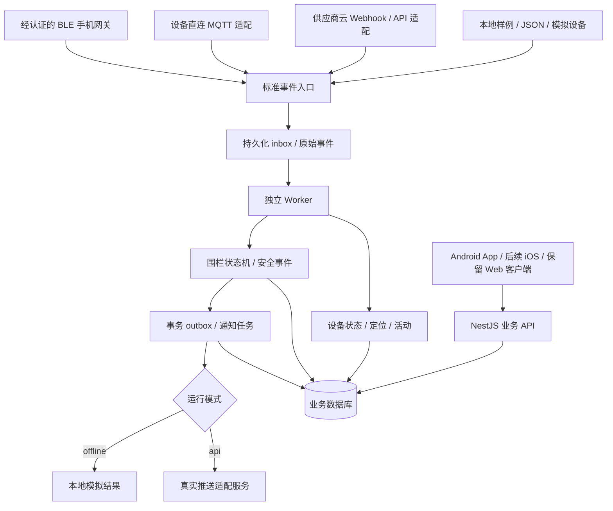

# DOOGY 智能项圈与宠物照护 App：主需求与后端集成方案

版本：2.4（项目交接核对版）
最近核对日期：2026-11-26（Asia/Shanghai）
适用范围：Android App 优先、中国大陆及海外地址配置、后续 iOS 和硬件集成。

本文件规定当前功能与边界，源码使用 React Native + TypeScript + Expo、NestJS API 和独立 Worker。当前协作以迁移和完善已实现的软件流程为目标，保持身体观察原文、不评分；硬件、真实模型、地图、身份与消息渠道满足各自接入条件后再启用。

本项目保持 61 张业务表及迁移管理表，最新 SQLite 034、PostgreSQL 023。数据结构与模块接口见 [数据库说明](docs/database-dataflow.md)、[前后端接口](fb.md)、[需求状态](docs/requirements-status.md) 和 [51 画板操作表](docs/app-closed-loop.md)。本源码包不附本机历史数据、APK或验收归档，当前验证由 [协作流程](docs/process.md) 记录。

新接手人员先读 [项目交接文档](项目交接文档.md)，再按 [项目需求与开发任务](项目需求与开发任务.md) 核对已实现、待验收、待接入及待确认事项；本文件继续作为完整需求依据。

## 1. 文档依据与阅读约定

功能依据为本文件、现有源码与模块合同。Figma 的参考链接与第21节节点清单用于核对操作顺序，不要求复刻视觉；未取得的最新原型连线、公式或硬件能力不能推断为已确认需求。

| 状态 | 含义 |
| --- | --- |
| 已实现 | 源码存在对应 API / App 操作；不自动等同真机、硬件或生产验收 |
| 待开发 | 已确定后续工作，不能显示为当前可用能力 |
| 待确认 | 依赖产品、区域、供应商、样机或真实验证后冻结的决策 |

当前状态以 [需求核对](docs/requirements-status.md) 为入口，接口字段、错误和调用顺序以 [fb.md](fb.md)、模块文档及代码共同核对。

## 2. 最终决策与冲突处理

| 议题 | 最终方案 | 理由与边界 |
| --- | --- | --- |
| App 技术栈 | React Native + TypeScript + Expo development build，工程放在 `mobile/` | 复用已有 TypeScript 合同；原生模块后续按已确认能力增加，不用 WebView 包装现有页面替代原生交互 |
| 平台与区域 | Android 优先、iOS 后续；共用代码支持中国大陆和海外环境选择 | 区域标签与服务器地址显式配置；地图、通知、身份、硬件供应商仍待选择，不因选择区域就宣称已有当地服务 |
| 当前功能范围 | 迁移后端已实现功能，后续扩展另立验收 | 保持现有授权、数据与双模式行为；无接口的动作显示不可用及原因 |
| 后端语言与框架 | 延续 TypeScript + NestJS，一个业务主服务和独立 Worker | 仓库已有实现与测试；不因文档 B 推荐 FastAPI 而重新建设第二套业务服务 |
| 本地数据库 | SQLite WAL + SQL 迁移 | 无外部凭据即可开发、持久化、回放与联调；不把 SQLite 当作正式试点数据库方案 |
| 试点数据库 | PostgreSQL + PostGIS | 保留独立增量迁移、只读 SQLite 源到空 PostgreSQL 目标的导入；实库、原生备份/恢复和家庭试点分别验收 |
| TimescaleDB | 暂不引入 | 先验证数据量、查询和保留策略；出现明确瓶颈再评估，避免与 PostgreSQL 原生分区同时增加复杂度 |
| 队列 | 沿用 SQLite/PostgreSQL 数据库 inbox/outbox 持久队列 | 保持业务事务和消息处理可追溯；有扩容或托管运维需求时再选择一种队列，不同时建设 SQS、Redis Streams、Celery 等多套链路 |
| Redis | 按需要引入，非当前启动前提 | 仅放可重建缓存、限流和短时热状态，位置、绑定及告警事实仍在主库 |
| 云平台 | 中国大陆与海外使用同一业务代码、分别配置服务端地址；每个部署环境选择明确区域和主云 | 当前不自动跨区复制账号或业务数据；真实部署、地图、推送和数据流向按区域确认 |
| 软件运行模式 | 长期保留 `offline` 和 `api` | 两种模式共用数据合同和业务处理，拿不到 API 也能推进软件开发 |
| 真实接入路径 | 按硬件能力选择供应商云 Webhook/API 或设备直连 MQTT | 不能在供应商未定时承诺设备可连接自有 Broker；先实现其中一条实际链路 |
| BLE 手机网关 | 允许用于配对、样机和室内联调 | 不能代替宠物离开手机后的独立远程链路，也不能据此验收走失能力 |
| 标准事件 | 沿用现有 `schema_version/event_id/device_ts/boot_id/seq/event_type/payload` | 文档 B 的 `schema_ver/t_device/loc/power/link` 作为供应商输入映射，避免两套标准并存 |
| 围栏 | 已支持固定/动态缓冲、连续点和驻留时间确认 | 参数需现场校准，真实定位表现以样机验收为准 |
| 走失模式、策略回执、诊断包 | 软件合同已有，实际执行按硬件支持联调 | 下行命令需回执，诊断快照依用户授权 |
| 订阅与支付 | 试点先手动管理试用权益和统计用量；支付后置 | 不让商业模块阻塞安全链路验证，不凭空冻结套餐、定价或支付供应商 |
| AI | 已有规则观察、解释任务、本人问答、证据和反馈；真实模型未接入 | offline 固定演示；api 明确 MODEL_NOT_CONFIGURED；定位、告警和日常看板独立运行 |

开发原则：优先完成真实可验证的业务闭环；仅保留必要的权限、输入校验、事务和幂等；不为假设中的规模搭建微服务、复杂抽象、多区域双活或大量空模块。

## 3. 产品目标与交付范围

### 3.1 三个核心场景

1. **日常照护**：主人能了解设备状态、当日活动和手工照护记录，知道数据从哪里来、缺了什么。
2. **安全变化**：围栏、电量、设备失联和位置陈旧分别提醒，事件具备依据和处理时间线。
3. **寻找宠物**：在独立远程链路可用时，展示最近可用位置、采样时间、精度和链路状态，避免把历史位置当成实时位置。

第一阶段以可信位置、可解释告警和持续照护为主，试点目标是验证可靠性、持续使用与付费意愿，不以功能数量作为完成标准。

### 3.2 范围分层

| 层次 | 必须交付的能力 | 当前状态 |
| --- | --- | --- |
| 移动客户端 | 账号、家庭、宠物、照护、健康、设备、安全、内容、行为、问答和数据管理 | 软件流程及媒体采集/导入已有实现；真机、硬件、外部集成及生产发布按各自条件验收，见 [51画板](docs/app-closed-loop.md) 与 [验收清单](docs/acceptance.md) |
| 本地软件基线 | 账号、家庭、宠物、设备绑定、遥测、轨迹、静态围栏、安全事件、通知、活动、照护、概览、证据与反馈 | 已有本地版本 |
| 双模式联调 | 离线样例、标准 JSON 导入、模拟设备、标准 HTTP 入口、供应商验签入口 | 已有；具体供应商映射待开发 |
| 试点接入 | 实际远程设备链路、生产身份、真实推送、PostgreSQL/PostGIS、策略与回执、诊断与监控 | 双库、策略回执、诊断和简报已有本地实现；真实设备、生产身份与移动推送待联调 |
| 走失增强 | 主人开启寻找会话、策略升频请求与执行状态、必要的紧急联系人授权 | 寻找会话、命令状态、到期恢复、临时分享、联系人及文字通知本地请求已有；真实升频、投递与链接通知待确认/接入 |
| 运营验证 | 试用权益、用量、故障工单、可靠性简报、用户反馈 | 工单、简报、失败消息重排和观察反馈已有；试用权益及现场统计待开发/确认 |
| 后续能力 | 自动订阅支付、复杂行为模型、开放生态 | 不作为当前试点闭环前置条件 |

当前 MVP 范围排除 UWB 方向寻找、向犬自动声振干预、随人移动围栏、未经验证的心率/呼吸/体温、疾病诊断、确定情绪、自动饮食处方、社区、保险和智能喂食生态。第 21 节记录设计中的相关新增能力，按产品确认、设备能力和证据门槛安排后续交付。OTA 待硬件签名、升级与回滚链路成熟后另行实施。

## 4. 总体架构与项目落点



图中 MQTT、BLE 网关、供应商原始协议适配和真实移动推送是目标接入能力，不代表当前均已实现。

| 模块/目录 | 当前职责 | 下一步主要工作 |
| --- | --- | --- |
| `mobile/` | React Native/TypeScript App、会话、区域/服务器配置、导航及原生交互；Android内测包与API34模拟器基本流程已验收 | 补齐完整表单、ARM64真机、系统交互与后续iOS验收 |
| `src/identity.ts`、`src/password-recovery.ts` | 账号、会话、家庭成员、宠物授权、时区，以及本地找回/一次性重置 | 真实邮件投递、邮箱核验、社交及生产身份 |
| `src/devices.ts`、`src/device-credentials.ts` | 设备预置、绑定、解绑、所有权、绑定码重签和凭证生命周期 | 真实设备配对、凭证下发与固件联调 |
| `src/reporting.ts` | 期望/已应用策略、命令回执、走失会话及到期恢复 | 供应商下行适配、真实执行与失败验收 |
| `src/telemetry.ts` | 标准合同、持久化接收、来源元数据、位置/活动投影、处理延迟与维护事件 | 供应商字段映射和真实接入 |
| `src/fences.ts`、`src/geofence-engine.ts`、`src/safety.ts` | 圆形/多边形、动态缓冲、点数与持续确认、规则版本、事件详情及人工确认 | 来源规则和围栏参数的实地校准 |
| `src/notifications.ts` | 偏好、任务、重试、租约、站内列表、HTTP 推送合同 | 实际渠道适配、终端送达回执与升级规则 |
| `src/care.ts`、`src/observations.ts`、`src/wellness.ts`、`src/nutrition.ts` | 照护及修订、日/周统计、概览、目标/计划、身体原文、营养、时段/趋势及规则证据，App已接 | 当前终端逐项核对；不评分，新硬件指标另行确认 |
| `src/integrations.ts` | 双模式状态和供应商 HMAC 入口 | 特定供应商契约及实际端到端验证 |
| `src/shares.ts`、`src/support.ts`、`src/operations.ts` | 临时分享、工单、诊断授权、家庭简报和失败重排 | 真实客服值守与试点统计 |
| `src/account-export.ts`、`src/privacy.ts`、`src/retention.ts`、`src/inventory-retention.ts` | 授权导出、注销、共享删除、自动保留和恢复删除日志；App已有配置、预览与显式操作入口 | 独立合成库终端操作及正式交付流程验收 |
| `db/`、`scripts/`、`test/` | 双库增量迁移、导入、备份恢复、离线演示和回归 | 新实体双库迁移、真实试点验收场景 |

初期一个 API 服务、一组 Worker、一个主数据库即可。Worker 可以按职责组织代码，不要求立即拆成多个独立服务。当前 SQLite 版本按单 Worker 开发运行；已有独立连接消费测试不等于已完成多进程并发压测。

## 5. `offline` / `api` 双模式合同

软件模式与传输路径是两回事：模式决定是否允许真实外部业务调用，传输路径决定数据怎样到达后端。两种模式保持相同的业务 API、授权、标准事件、数据库关系和计算规则。

| 项目 | `offline` | `api` |
| --- | --- | --- |
| 默认用途 | 无供应商 API 时的软件开发、回归、演示 | 真实设备/供应商/推送联调 |
| 数据入口 | `demo`、JSON 数组导入、模拟器调用标准入口 | 标准设备入口、供应商验签入口；后续实际传输适配 |
| 设备身份 | 预置独立模拟设备身份 | 对应生产设备/供应商服务身份 |
| 业务处理 | 真实执行持久化、权限、幂等、围栏和聚合 | 与离线共用处理逻辑 |
| 通知 | 始终 `simulated`，即使环境残留推送 URL 也不发送 | 真实适配服务接受后才标记 `sent` |
| 缺少配置 | 不依赖外部配置即可开发 | 不伪造成功；供应商缺少密钥返回配置错误，推送任务保留 `pending` |
| 本地文件导入 | 允许；相同事件可重复导入 | 禁止调用离线导入脚本 |
| 能证明什么 | 软件合同和业务流程可运行 | 仅对实际配置并验证的外部链路作出结论 |

**模式切换不等于数据库迁移，也不等于自动完成平台集成。** `DATA_MODE` 决定外部业务调用模式，`DB_DRIVER` 独立选择已支持的 SQLite 或 PostgreSQL/PostGIS；SQLite 使用 `DB_PATH`，PostgreSQL 使用 `DATABASE_URL`。切换配置不会自动迁移已有数据，导入及试点切换需独立验收。测试和真实环境应使用独立数据库、设备及密钥，避免合成数据进入试点数据集。

现有配置：

```dotenv
DATA_MODE=offline
DB_DRIVER=sqlite
DB_PATH=./data/doogy.db
FRESH_SECONDS=300
OFFLINE_SECONDS=300
LOW_BATTERY_PCT=20
```

API 模式补充配置：

```dotenv
DATA_MODE=api
VENDOR_WEBHOOK_SECRET=replace-with-at-least-24-random-characters
PUSH_WEBHOOK_URL=https://your-authorized-push-adapter.example/notifications
PUSH_WEBHOOK_TOKEN=replace-with-adapter-token
```

配置示例不是可用凭据。当前不通过环境变量自动获取供应商数据；若供应商只支持主动拉取 API，需开发分页、时间窗、重试、断点和权限验证后，转换到同一入口。

## 6. 账号、家庭、宠物与设备所有权

### 6.1 权限模型

沿用 `households` 和成员角色：

| 角色 | 权限 |
| --- | --- |
| `owner` | 管理本家庭成员与宠物；执行家庭级敏感操作 |
| `caregiver` | 查看宠物与设备，按授权修改档案、照护和围栏 |
| `viewer` | 只读查看所共享家庭的宠物、位置、活动、安全事件和相关通知 |
| 客服账号 | 按配置名单处理工单，仅在有效授权下查看诊断快照，家庭角色独立判断 |
| 后续紧急联系人 | 仅通过显式授权的临时共享资源访问必要信息，不获得永久家庭访问权 |

所有对象访问在业务服务层检查成员身份和角色，撤销后立即停止后续读取和待发送通知。知道 `pet_id`、`device_id` 或通知 ID 不构成访问权。

### 6.2 设备绑定与转移

1. 通过受控预置流程建立设备身份和短期一次性绑定码；二维码不包含长期设备密钥。
2. 绑定需要宠物写权限、正确绑定码、有效期限和未被占用的绑定关系。
3. 一台设备同时绑定一只宠物，一只宠物在当前版本同时绑定一台设备，保留所有绑定历史。
4. 设备所有权和宠物家庭访问权分离。设备所有者即使已离开某个家庭，仍可以解绑自己的设备，但不能继续读取该家庭位置。
5. 解绑后清除当前最新位置指针和围栏候选状态，关闭该设备当前打开的安全事件；释放所有权后才允许其他人重新认领。
6. 队列保存接收时的绑定身份。旧绑定排队消息不能投影到新绑定；换绑后收到早于新绑定的补传数据，不进入新宠物的位置或活动视图。
7. 已实现绑定码过期/锁定后的受控重新签发、凭证吊销与轮换；真实设备的安全下发、烧录和轮换需随硬件联调验收。

当前本地认证使用密码散列、短期访问令牌和可撤销/轮换的刷新令牌，另提供offline受控本地投递的一次性密码找回；成功重置撤销全部会话。生产身份、邮箱验证、真实邮件和第三方登录在供应商合同确定后接入，不将本地会话实现描述为已接入 OIDC。

## 7. 统一事件合同与供应商适配

### 7.1 已有 v1.0 标准

```json
{
  "schema_version": "1.0",
  "event_id": "report-unique-0001",
  "device_id": "00000000-0000-4000-8000-000000000001",
  "event_type": "location.reported",
  "device_ts": "2026-11-17T03:12:08.120Z",
  "boot_id": "boot-20261117-01",
  "seq": 18421,
  "firmware_version": "0.1.0",
  "payload": {
    "lat": 31.2304,
    "lon": 121.4737,
    "accuracy_m": 12.4,
    "source": "gnss",
    "battery_pct": 63
  }
}
```

设备 UUID 为格式示例，必须替换为实际预置设备。事件类型已经支持 `location.reported`、`state.reported`、`activity.reported`。`received_at` 由服务端生成并保存，不能信任客户端提供的接收时间。

| 字段 | 统一含义 |
| --- | --- |
| `schema_version` | 合同版本；当前实现接受 `1.0`，扩展需显式升级实现 |
| `event_id` | 全局业务消息身份，重试保持不变 |
| `device_id` | 已预置设备的服务端身份，不能仅由请求者任意声明 |
| `device_ts` | 设备实际采样时间，规范化为 UTC ISO-8601 |
| `received_at` | 服务端接收时间；与采样时间分别保存 |
| `boot_id` | 设备启动/会话身份，设备重启时变化 |
| `seq` | 同一启动会话内的消息序列；不是跨重启永久递增假设 |
| `source` | 定位/测量来源；与数据经由什么网络传输不同 |

幂等采用全局 `event_id` 和 `(device_id, boot_id, seq)`，修正文档 B 仅按 `(device_id, seq)` 去重的重启冲突。同一身份对应不同内容应报冲突，不能静默覆盖。

### 7.2 活动合同

活动上报使用区间总量：`start_at`、`end_at`、`steps`、`active_seconds`、`distance_m`、`sleep_seconds`、`estimated`、`source` 和必要原始指标。

- 明确指标是区间总量还是累计计数，累计值必须先经供应商适配转换。
- 未测量的字段省略或为 `null`，不补成零；不能仅凭 IMU 存在就宣布步数或睡眠算法可信。
- 区间长度、活动/睡眠时长及重叠关系做基本校验，避免重复统计。
- 同一设备的区间总量按当前合同不得重叠；若供应商支持重算，需要明确修订事件，不覆盖旧事件身份。

### 7.3 后续合同扩展

已支持可选 `transport`、供应商来源元数据和处理时间指标。充电状态、电压、定位质量附加字段、传感器算法版本及新的设备控制类型按供应商合同扩展，需同步 Schema、迁移、适配、API 输出和契约测试。现有配置命令通过专用设备轮询与回执入口处理。

`transport` 用于记录 `cellular`、`phone_gateway`、`vendor_cloud` 等链路；`source=gnss|wifi|cellular|ble|vendor` 描述定位来源，两者不能混用。

供应商适配规则：

1. 把 B 的 `schema_ver/t_device/loc.acc_m/power/link` 映射为统一字段，不在业务层同时维护两套命名。
2. 上游合并报文若拆成位置、状态、活动多个事件，必须分配各自稳定的 `event_id` 和不同序列，保存原消息与子事件映射；不能把同一 `boot_id + seq` 重用于多个子事件。
3. 重试/回放必须得到同一映射，源序列、供应商事件 ID 和时间语义可追溯，不能每次重放生成全新业务身份。
4. 没有设备启动身份、准确时间或稳定消息身份时，先确认供应商协议；适配器自行补充的字段必须标明来源和局限。
5. 不依赖事件到达顺序更新最新状态。旧点可以进入历史，但不能把新状态回退。

## 8. 接入、持久队列与处理事务

### 8.1 已有入口

- `POST /api/v1/ingest/events`：使用每台设备独立的 `x-device-token`。
- `POST /api/v1/integrations/vendor/events`：仅 API 模式，校验原始请求体 HMAC、时间窗口和已预置设备。
- 离线 JSON 导入：使用相同 Schema、设备身份、持久队列及 Worker。

供应商 HMAC 为 `HMAC-SHA256(secret, timestamp + "." + 原始请求体字节)`，请求使用 `x-doogy-timestamp` 和 `x-doogy-signature`，当前允许五分钟时间差。签名时间窗口不代替业务事件幂等。

### 8.2 处理步骤

1. 校验调用者/设备身份和标准消息，生成服务器接收时间。
2. 在事务中保存原始事件、绑定快照和幂等身份，返回 `202`。此响应只表示持久化接收，不代表围栏、推送或手机显示已经完成。
3. Worker 读取待处理事件；在事务中更新状态、位置/活动、围栏判断、安全事件和通知任务。
4. 投影失败时回滚该次业务改动，再记录重试或死信。重试不能产生半条位置、半条告警或重复通知。
5. 通知异步发送，失败退避；App 可通过站内事件读取完整上下文。

目标是允许重复投递并通过幂等约束避免重复业务结果，不宣称跨设备、网络和外部推送实现严格的 exactly-once。真实推送适配器应支持通知 ID 对应的幂等键，覆盖供应商已接受但本地尚未记录成功时的重试窗口。

当前 SQLite/PostgreSQL 共用业务身份和事务 outbox 语义。已提供家庭运行简报、当前绑定失败消息查看与有理由的受控重新排队；真实告警值守和托管队列扩展按试点需要安排。

### 8.3 MQTT 与手机网关

若硬件确认支持直连，Topic 统一使用：

```text
doogy/v1/devices/{device_id}/telemetry
doogy/v1/devices/{device_id}/events
doogy/v1/devices/{device_id}/state/reported
doogy/v1/devices/{device_id}/commands
doogy/v1/devices/{device_id}/commands/ack
```

每台设备仅能访问自身 Topic，生产采用供应商确认的独立证书/凭证。文档 B 的私有 Topic 在适配层映射，不再形成第二套业务合同。

BLE 手机网关后续需绑定已认证用户、已授权设备和真实近场会话；不能仅凭用户提交 `device_id` 就接受代报，也不能把设备长期密钥直接交给 App。网关认证的具体证明机制与固件协议一起确认。

## 9. 设备状态、上报策略与走失模式

### 9.1 独立表达三类状态

- **连通状态**：`online/offline/unknown`，依据心跳、连接事件和最后接收时间。
- **数据新鲜度**：`fresh/stale/missing`，依据采样时间、设备策略和当前时间。
- **位置可用性**：依据精度、来源、时钟和异常标记判断，不能由在线状态推导。

当前全局 `FRESH_SECONDS=300`、`OFFLINE_SECONDS=300` 是开发默认。已按设备**已确认应用**的上报周期计算 TTL，采用 `max(对应默认阈值, 3 × 已应用周期)`，并返回时间规则来源。低频静止等实际策略仍需经样机校准。

首次绑定后未有可显示位置时，概览已返回 `location_wait`，600 秒前为 `waiting`，达到 600 秒为 `delayed` 并提示检查佩戴、开阔处和链路。失联和位置缺失分别建事件，越界依有效定位判定。

### 9.2 拟议策略，均需固件与实测确认

| 模式 | 建议起点 | 说明 |
| --- | --- | --- |
| `home_idle` | 心跳 10–15 分钟，显著运动触发定位 | 省电；同步增大在线 TTL |
| `home_active` | 2–5 分钟或位移触发 | 日常轨迹，不能直接承诺快速越界发现 |
| `boundary_watch` | 30–60 秒 | 设备确有本地粗判断/升频能力时采用 |
| `alert` | 15–30 秒 | 走失/越界寻找，受网络和电量约束 |
| `low_power` | 动态降低普通上报，保留必要提醒 | 不保证低电量下仍能维持高频定位 |
| `offline_hold` | 设备本地缓存，恢复补传 | 缓存容量、顺序、时钟与耗电待供应商确认 |

仅由低频服务端位置判断接近边界时，云端可能很晚才知道越界。需要固件本地粗检测、可接受的常规采样周期或更宽告警目标共同解决，后端算法不能补回从未上报的数据。

### 9.3 走失模式与配置回执

已实现寻找会话，记录操作者、时间、期望策略及有效期。策略命令包含 `command_id`、`desired_version`、到期时间和设备身份，执行状态区分 `pending/applied/failed/expired/superseded/cancelled`。

设备回执确认 `applied_version` 后，App 才能显示策略已生效。设备离线、拒绝或超时，应明确显示尚未执行，并继续展示最后位置和时间。固件不支持下行控制时，只能提供寻找会话和当前能力提示，不能宣称已升频。

已实现关闭/到期后请求恢复先前策略并留审计。临时位置分享已有明确同意、有效期、撤销和访问范围，要求当前有效寻找会话。紧急联系人实体和通知流程按实际试点需要确认。

## 10. 定位、轨迹与质量规则

1. 主库存储 WGS84，经纬度命名固定；多边形坐标数组使用 `[lon, lat]`。地图若采用不同显示坐标系，在明确边界转换并标记，禁止直接混存。
2. 保存采样时间、接收时间、精度、定位来源和质量标记。`accuracy_m` 是定位引擎估计，不能解释为保证误差上限。
3. 非法经纬度拒绝入库；迟到、未来时钟、差精度或不合理速度保留可审计信息，分别处理，不能全部静默删除。
4. 超出允许时钟宽限的未来时间戳不能推进最新位置/围栏时间水位；当前容忍设备时间快 60 秒，超出才标记 `clock_ahead`。乱序和重放不能覆盖更新状态。
5. 当前 `latest` 返回当前绑定位置及 `quality_flags`、`usable_for_tracking`、`usable_for_geofence`。最新点不可追踪时，`last_usable_location` 可提供同一绑定内仍满足质量和新鲜度要求的位置。`fresh` 仅表示时间较新，位置可用性需同时满足质量条件。
6. 围栏默认只使用已验证来源，初始白名单为 GNSS；非 GNSS 来源可显示并标明来源，是否参与确定越界需实测批准。
7. Worker 重放时重新检查**处理当下**的新鲜度。到达时新鲜的排队消息，在几分钟后处理也不能当作当前越界依据。
8. 轨迹使用 `[from,to)` 和稳定游标分页，默认读取最近 24 小时，单次范围最多 31 天。授权数据导出按现有清单逐页读取，异步导出任务按实际交付需要安排。

历史补传能完善轨迹，不能让 UI 把历史采样时间改成服务器当前时间。位置陈旧时展示“最后已知位置/无法确认当前位置”，而不是确定的安全结论。

## 11. 静态围栏与安全事件

### 11.1 统一判定模型

第一版只支持静态圆形和简单多边形。当前本地几何算法可用于联调；大范围、极区和跨日期变更线等情况不在本地多边形近似的验证范围，正式试点使用 PostGIS 并限定业务允许的围栏范围。

统一有符号距离定义：围栏外为正、内为负。当前可配置的判定规则：

- `buffer = max(configured_buffer_m, accuracy_m, min_buffer_m)`，`min_buffer_m=15` 米可作为实测起点。
- `d > buffer` 为确定在外，`d < -buffer` 为确定在内，缓冲带内为 `uncertain`。
- 点需同时满足来源、精度和当前新鲜度规则，否则为无法判断。
- 候选状态需至少 `N` 个连续有效点，启用最小驻留时间后还需满足 `T`。时间达到本身不能在没有新有效点时自动证明越界。
- `N=2`、驻留 30–60 秒仅为候选参数；应与 15–30 秒等实际上报周期一同校准，不能把它们同时写成已达成的延迟承诺。
- 无效/不确定点、明显时间断层重置候选连续性；乱序点不回退水位，未来点不阻塞后续正常判断。

当前已有固定 `buffer_m`（默认 10 米）、`confirm_points`（默认 2）、精度阈值（默认 100 米），以及可选动态缓冲、最小缓冲和进出驻留时间。判断使用已支持的位置来源与质量规则；来源白名单的产品配置合同和参数校准仍需确认。每次实际规则修改保留版本，判断记录保存原因和有效缓冲。

### 11.2 状态和事件

稳定状态使用 `unknown/inside/outside`，候选状态独立保存。`unknown` 下首次可靠区内点可以建立基线，首次区外判断也需确认。参与处理的点保存位置 ID、判断结果、状态快照、计算时间、规则版本、判断原因和有效缓冲；乱序点可能跳过围栏计算。现场完整回放和校准仍需结合样机证据。

当前事件命名统一沿用：

| 事件 | 当前实现/后续行为 |
| --- | --- |
| `geofence.exited` | 已有；确认转换时创建一次越界事件并生成通知 |
| `geofence.entered` | 已有；关联原越界事件并关闭该次打开事件 |
| `battery.low` | 已有；同一未恢复区间去重，恢复后可开启新的低电事件 |
| `device.offline` | 已有；与越界分开，不因历史队列重放而反复恢复/失联 |
| `location.stale` | 已有；位置陈旧或绑定后长期缺失，不能用历史补点错误关闭 |
| `battery.critical`、`device.online`、`location.uncertain` | 待开发；是否需要独立事件由试点策略确定 |
| `lost_mode.started/stopped` | 待开发，区分用户意图和设备策略执行状态 |

业务事件状态、人工确认和通知状态分别管理。新事件关闭时写入 `closed_reason`，列表、详情和授权导出沿用同字段；旧记录保留原关闭时间与null原因，页面显示未知。该字段通过SQLite023/PostgreSQL012增量引入，当前全库版本见第15节。

| 关闭原因 | 发生条件 |
| --- | --- |
| `geofence_returned` | 新定位满足返回确认规则，关闭既有越界事件 |
| `geofence_entry_recorded` | 进入围栏事件在记录时完成 |
| `fence_disabled`、`fence_rule_changed` | 停用围栏或改变判断规则，关闭相关开放事件 |
| `device_unbound` | 解绑设备，关闭该设备相关开放事件 |
| `device_reconnected`、`battery_recovered`、`location_recovered` | 连通、电量或有效定位恢复，关闭对应开放事件 |

事件关闭后可根据原因追溯处理动作。返回围栏由定位判定，人工确认仅记录知晓与处置，通知已读仅更新本人记录。

## 12. 通知、回执与告警确认

已有通知链路为：安全事件 → 持久化通知任务 → 当前成员和偏好检查 → 模拟或 HTTP 推送适配 → 结果与重试。成员撤销后不再发送新的敏感事件详情；推送仅带必要事件标识，App 再经授权拉取上下文。

| 层次 | 状态/时间 | 能证明什么 |
| --- | --- | --- |
| 业务事件 | `open/closed`，发生与关闭时间 | 风险/状态转换的业务生命周期 |
| 通知任务 | `pending/processing/sent/simulated/skipped/dead` | 排队、处理、供应商接受、模拟或失败结果 |
| 手机送达 | 后续渠道支持时记录 `delivered_at`；否则未知 | 有可信渠道/终端回执时才能说明送达 |
| 已读 | 当前已有 `read_at` | App 用户已执行已读操作 |
| 人工确认 | 已有 `user_id/acknowledged_at/note` | 主人或照护者表示已知晓，事件状态独立保留 |

不把 `sent`、`delivered`、`read` 和 `acknowledged` 串成必然都会出现的状态链。FCM/APNs 或适配服务接受，不代表手机显示，更不代表主人看到。

站内事件详情、人工确认、失败状态和最终失败通知重排已实现。试点前继续补齐目标区域的真实渠道、终端权限验证、通知静音/抑制及关键告警升级规则。现有 `PUSH_WEBHOOK_URL` 指向自有/授权推送适配服务，实际 FCM/APNs 需要对应适配与终端验收。

当前重试有退避、死信和租约恢复；旧 Worker 的迟到结果不能覆盖新领取者的成功状态。站内历史始终保留，手机推送不是唯一告警记录。

Web 通知中心提供本人通知的全部、未读、已读筛选和分页，可以查看关联事件及标记本人已读。围栏进出、低电、设备离线和定位过期四类提醒可分别设置。关闭类别后停止为本人生成该类新通知，既有通知和安全事件仍可查阅。页面区分投递结果、本人已读和家庭确认，手机实际送达显示未知。

## 13. 活动、照护、日常摘要与证据解释

### 13.1 活动和时间语义

- 日/周统计按 IANA 时区自然日生成，并返回 UTC 区间、样本数、覆盖时长、来源、估算标记和缺失状态。
- 已支持家庭/宠物持久化 IANA 时区，读取按请求、宠物、家庭依次确定，最终默认 `Asia/Shanghai`；响应返回实际使用的时区。
- 缺失指标返回 `null`；无样本不解释为零活动、正常睡眠或宠物无异常。
- 跨午夜区间按重叠时长分配并标记估算；这不是逐秒活动实测，夏令时自然日可能不是 24 小时。
- 完整自然日使用 `daily_summaries` 保存 `aggregation_version`、来源修订、覆盖率和更新时间，迟到数据使旧摘要失效并回算。今日同进度比较按请求时点读取区间明细。
- 已汇总设备提供的睡眠分钟和逐指标覆盖率；睡眠分期、热量、静息心率与剩余续航等按第 21 节的实际输入及算法能力开放，缺少数据时保留未知。

### 13.2 手工照护

已有体重、饮食、用药、护理、备注记录，具备 `source=owner|vet`、记录时间、操作者和修改历史。`vet` 是用户声明来源，不表示系统完成兽医身份核验。修改保留快照，旧体重不能覆盖时间更新的体重。

已补齐编辑幂等、单条读取与显式软撤回：当前可写作者或家庭 owner 提供原因撤回，保留原记录、修订与操作者；默认列表和概览隐藏撤回记录，授权查看/导出可查撤回状态。撤回后禁止继续编辑，旧创建回执重放不重新生成记录。体重只从仍有效的体重记录按记录时间、创建时间、ID 回算，无有效记录时为未知，不推断已被覆盖的手填基线。恢复旧备份时通过最小撤回日志恢复状态；日志不含原理由或作者，系统重放不伪造人工修订。接口和验证见 [care-withdrawal.md](docs/care-withdrawal.md)。

已增加如厕和自定义类型：`type=toileting` 的 value.kind 记录 urination/defecation/both 三种事实，`type=custom` 必填顶层 custom_type 名称。名称按记录保存，可编辑和精确筛选；原有新增、历史、撤回、概览和导出流程统一支持这两种类型。接口示例见 [care-types.md](docs/care-types.md)。已支持 JPEG/PNG/WebP 图片及 PDF 附件上传、列表和原文件下载，单文件最多 5MiB、每条记录最多十份；内容随数据库备份和授权导出保存，撤回后的历史附件继续可读，细节见 [care-attachments.md](docs/care-attachments.md)。不把未上报或未填写的记录当作否定发现。用药记录是主人手工事实，不提供用药建议。软撤回保留历史；需要清除宠物/家庭共享数据时仍使用现有显式删除流程。

### 13.3 今日概览目标

在现有宠物、设备、位置、活动、照护和安全事件概览上，已聚合围栏有效状态、待确认风险、本人未读通知和数据缺口；策略执行与走失继续通过现有 device.reporting 展示。待办计数覆盖全部当前相关记录，两个摘要数组各最多五条，避免原最近十个事件掩盖较早待办。确认、风险关闭、通知已读和发送状态分别展示。

current_state_at 明确设备、位置、围栏和待办的当前读取时点；date/timezone 只选择活动与照护自然日，不能把当前状态当作历史快照。缺口区分所选活动日期和当前状态，不推断未佩戴、零活动或疾病。接口及数据口径见 [overview.md](docs/overview.md)。每项信息应回答：发生了什么、依据是什么、主人可以做什么。

### 13.4 规则观察与 AI

已实现完整自然日观察，以及 `GET /pets/{id}/observations/current` 的今日实时同期比较：按当地午夜起相同已过时长，对比前七个自然日中的合格窗口，分别计算步数与活动分钟的中位数、百分比变化和覆盖率。目标与历史各指标覆盖至少 50%，至少三个合格历史窗口；历史自然日不足同等时长时排除，午夜零时长返回尚未开始。实时结果按请求回算，不写入整日缓存。Web 可查看完整自然日的规则观察及证据，主人或照护者通过 `POST /pets/{id}/feedback` 引用保存的观察和证据提交反馈。时间口径及请求合同见 [current-observations.md](docs/current-observations.md)。

1. 为有效数据天数、覆盖率和可比较时间段设门槛；不足时显示正在建立基线。
2. 用规则生成相对该宠物历史的观察，明确比较窗口、来源、计算版本和缺失情境。
3. 保存完整自然日的证据与人工反馈。后续需要自然语言解释时，再异步接入 LLM，输出绑定证据 ID、模型版本和不确定性。
4. 无证据支持的判断不生成。禁止疾病诊断、用药建议和确定情绪；体重、热量、睡眠及休息窗分别说明手记/设备/估算属性。

不把“近 7 日”和“近 14 日”同时固定为所有指标的通用基线；按指标和覆盖要求选择，纳入规则版本。AI 不负责判定设备成功执行，也不控制设备或成为围栏链路的依赖。

## 14. API 统一清单

统一前缀 `/api/v1`，JSON，UTC ISO-8601，错误含 `code/message/request_id`，分页返回 `items/next_cursor`。不另建文档 B 的 `/v1` 路由别名，避免同一业务出现两套名称。

### 14.1 已有 API

| 领域 | 方法与路径，不含公共前缀 |
| --- | --- |
| 健康与模式 | `GET /health`、`GET /integrations/status` |
| 账号 | `POST /auth/register`、`POST /auth/login`、`POST /auth/refresh`、`POST /auth/logout`、`GET /auth/me` |
| 家庭 | `GET /households`、`PATCH /households/{id}`、`GET /households/{id}/members`、`POST /households/{id}/invitations`、`POST /invitations/{token}/accept`、`PATCH/DELETE /households/{id}/members/{userId}`、`POST /households/{id}/owner` |
| 宠物 | `GET/POST /pets`、`GET/PATCH /pets/{petId}` |
| 设备 | `GET /devices?limit=&cursor=`（仅本人持有安全元数据）、`POST /devices/claim`、`GET /devices/{deviceId}`、`POST /devices/{deviceId}/unbind`、`POST /devices/{deviceId}/release`、`POST /devices/{deviceId}/claim-code` |
| 凭证维护 | `GET /devices/{id}/credential`、`POST /devices/{id}/credential/rotate`、`POST /devices/{id}/credential/revoke`；管理员 `POST /admin/devices/{id}/credential/rotate`、`POST /admin/devices/{id}/claim-code` |
| 上报策略与寻找 | `GET/PUT /devices/{id}/reporting-policy`、`POST /devices/{id}/lost-mode`、`GET /devices/{id}/commands/{commandId}` |
| 设备命令入口 | `GET /device-ingress/{id}/commands`、`POST /device-ingress/{id}/commands/{commandId}/ack`，使用设备令牌 |
| 遥测 | `POST /ingest/events`、`GET /ingest/events/{eventId}`、`POST /integrations/vendor/events` |
| 位置 | `GET /pets/{petId}/location/latest`、`GET /pets/{petId}/locations?from=&to=&limit=&cursor=` |
| 围栏 | `GET /pets/{petId}/geofences`、`POST /geofences`、`PATCH/DELETE /geofences/{id}`；DELETE 为停用 |
| 安全事件 | `GET /pets/{petId}/safety-events`、`GET /safety-events/{id}`、`POST /safety-events/{id}/ack` |
| 临时位置分享 | `POST/GET /pets/{id}/location-shares`、`DELETE /location-shares/{id}`、公开令牌读取 `GET /location-shares/{token}` |
| 活动 | `GET /pets/{petId}/activity/daily?date=&timezone=`、`GET /pets/{petId}/activity/weekly?date=&timezone=` |
| 照护 | `GET /pets/{petId}/care-records`（type/custom_type/status 筛选）、`POST /care-records`、`GET/PATCH /care-records/{id}`、`POST /care-records/{id}/withdraw`、`GET /care-records/{id}/history` |
| 照护附件 | `POST/GET /care-records/{id}/attachments`、`GET /care-attachments/{id}/content` |
| 概览与证据 | `GET /pets/{petId}/overview`、`GET /pets/{petId}/features`、`POST /pets/{petId}/feedback` |
| 活动观察 | `GET /pets/{petId}/observations?date=&timezone=`、`GET /pets/{petId}/observations/current?timezone=` |
| 通知 | `GET /notifications`、`PATCH /notifications/{id}/read`、`POST /notifications/{id}/retry`、`GET/PATCH /notification-preferences` |
| 推送终端 | `POST /push-tokens`、`DELETE /push-tokens/{id}` |
| 工单与诊断 | `POST/GET /support/tickets`、`GET /support/tickets/{id}`、`DELETE /support/tickets/{id}/diagnostics-consent`；客服 `GET /admin/support/tickets`、`GET/PATCH /admin/support/tickets/{id}`、`GET /admin/devices/{id}/diagnostics` |
| 授权导出 | `GET /auth/data-export`、`GET /auth/data-export/{section}` |
| 注销与共享删除 | `GET /auth/account-deletion`、`DELETE /auth/account`；`GET /pets/{id}/deletion-preview`、`DELETE /pets/{id}`；`GET /households/{id}/deletion-preview`、`DELETE /households/{id}` |
| 家庭保留 | `GET/PATCH /households/{id}/retention`、`POST /households/{id}/retention/preview`、`POST /households/{id}/retention/run` |
| 库存保留 | `GET/PATCH /admin/retention/inventory`、`POST /admin/retention/inventory/preview`、`POST /admin/retention/inventory/run` |
| 运行与失败恢复 | `GET /households/{id}/operations`、`GET /pets/{id}/telemetry-failures`、`POST /ingest/events/{id}/retry` |

业务 API 使用用户令牌；遥测入口使用设备或供应商服务身份，不能相互替代。Swagger 位于 `/docs`，机器可读定义位于 `/openapi.json`。

### 14.2 规划合同与后续扩展

既有接口采用上表实际路径，新增设计操作按第 21 节逐项定义。以下保留依赖供应商或正式交付方式的后续合同。

| 优先级 | 方法与路径 | 必须返回/约束 |
| --- | --- | --- |
| 按试点需要 | `POST /devices/{id}/gateway/telemetry` | 网关会话、绑定设备和近场证明；复用事件合同 |
| 正式交付确认后 | 导出/删除的异步受理与完成通知，具体路径待定 | 复用现有导出与删除服务，明确身份确认、范围、任务状态和完成证明 |
| 后续 | `GET /pets/{id}/explanations/latest` | 结构化证据、文本、规则/模型版本，不阻塞核心业务 |
| 商业验证后 | 权益查询、受控手动开通、支付 Webhook | 供应商与产品策略确认后再定路径和事件合同 |

预留合同统一命名、输入输出和后续任务。第 21 节的新增设备动作与解释数据需在标准合同显式扩展后启用，当前策略回执继续沿用现有接口。

当前关键创建、安全确认、客服、失败重试、设备上报策略/走失、照护编辑/撤回、附件上传及关联观察反馈支持可选 `Idempotency-Key`，已有有限回执窗口与自动清理，轨迹范围也已实现。设备命令按当前绑定和权限校验，回执保留首次操作结果，实时状态由查询读取；照护撤回后禁止继续编辑/上传，旧创建回执不重新启用记录。附件幂等保存文件摘要和元数据。合同见 [命令幂等说明](docs/command-idempotency.md) 与 [照护附件说明](docs/care-attachments.md)，最新验证见 [协作流程](docs/process.md)。其余写接口及按用户/设备/IP 分层限流仍待完善。

## 15. 数据模型、存储与迁移

### 15.1 核心实体

| 实体 | 当前状态与关键职责 |
| --- | --- |
| `users/sessions` | 已有；账号、散列凭据、访问/刷新会话 |
| `households/household_members/household_invitations` | 已有；家庭边界、角色、邀请与撤销 |
| `pets/household_settings/pet_settings` | 已有；档案、有效人工体重和持久化时区，返回实际生效时区 |
| `devices/device_bindings/device_state` | 已有；设备主档、所有权、绑定历史、最新状态 |
| `device_events` | 已有；原始标准事件、绑定快照、处理状态、重试与幂等 |
| `locations` | 已有；坐标、时间、精度、来源、启动序列和质量标记 |
| `geofences/geofence_states/geofence_evaluations` | 已有；配置、候选/稳定状态、规则版本、判断原因和有效缓冲；现场完整回放待验收 |
| `safety_events/safety_acknowledgements` | 已有；统一安全事件、关闭原因及独立人工确认 |
| `activity_samples` | 已有；活动区间及实际提供的指标 |
| `care_records/care_record_revisions` | 已有；人工记录与修改历史 |
| `notifications/notification_preferences/push_tokens` | 已有；接收人、任务状态、偏好、终端与发送租约 |
| `behavior_feedback/audit_logs` | 已有；反馈和敏感操作审计 |
| `reporting_policies/device_commands/lost_mode_sessions`、设备凭证元数据 | 已有；期望与已应用策略、回执、寻找会话、凭证版本和状态 |
| `activity_versions/daily_summaries/activity_observations` | 已有；来源修订、聚合版本、覆盖率、完整自然日观察和反馈关联；模型解释后续安排 |
| `support_tickets/support_ticket_history/location_shares` | 已有；工单回复、可撤销诊断授权和临时分享 |
| `household_retention/inventory_retention/privacy_deletions` | 已有；家庭/库存保留策略与恢复删除重放 |
| `user_profiles/user_consents/user_onboarding/pet_avatars` | 已有；显示名、逐版条款接受、可恢复引导及当前头像 |
| `pet_goals/body_check_ins` | 已有；按生效日版本化的目标/计划，以及原文身体观察修订 |
| `content_items/content_versions/learning_progress/health_observation_reads` | 已有；发布/审核版本、本人学习和完整日活动评估已阅 |
| `pet_media/behavior_records/interpretations/assistant_conversations/assistant_messages` | 已有真实媒体校验上传、授权读取/删除、人工行为、解释任务与本人问答；共享资料与本人会话分别授权，真实模型未接入 |
| `pet_configuration_history/household_contacts/password_recovery_requests` | 已有；配置修改、成员报告同意联系人、本地一次性密码恢复 |
| `contact_alerts/contact_alert_recipients` | 已有；message_only 文字请求及逐人模拟/失败/取消，不复制地址或分享令牌 |
| 外部身份、正式评分、试用权益与新增设备动作 | 待开发/确认；不因 App 页面存在就创建无后端依据的数据 |

当前源码共 61 张业务表，最新 SQLite `034`、PostgreSQL `023`；业务表不含 `migrations` 与 PostGIS 扩展对象。用户原库应用了哪些迁移以实际数据库为准，App 不直接打开或复制这些服务端数据库。

生产私钥不作为数据库明文字段；设备凭证表保存标识、状态和轮换元数据，敏感材料使用目标平台的密钥管理能力。

### 15.2 SQLite → PostgreSQL/PostGIS

当前支持双库增量迁移、SQLite只读源导入空PostgreSQL目标、备份/恢复、托管轮转与隔离并发验证入口。实际实库、原生恢复和试点切换按 [验收清单](docs/acceptance.md) 分别执行，不从接口存在推导已通过。

1. 先建立与当前领域关系等价的 PostgreSQL 迁移，保留 UUID、UTC 时间和幂等身份，不在迁移同时重写业务语言。
2. 为活跃设备/宠物绑定、事件身份、家庭成员关系建立必要唯一约束；检查外键和历史归属。
3. 定位按 `pet_id + device_ts + id`、设备时间建立索引，围栏建立空间索引；明确地理距离以米计算，避免把经纬度角度当米。
4. 按实际数据量决定是否对定位表进行时间分区。若采用分区，需单独设计全局事件幂等和分区唯一约束，不假设原 SQLite 唯一索引可以原样复制。
5. 迁移队列领取、事务和租约；用同一批离线场景对比两种数据库输出，验证重复、乱序、重启和转移隔离。
6. 对已有数据演练导入，核对行数、外键、最新指针和事件关系；定义切换、备份和回退步骤后再接真实用户。

SQLite 离线开发路径继续保留；当前代码已支持两种数据库。后续维护仅抽取实际重复的必要存储边界，不为未实现平台建立通用插件体系。

## 16. 隐私、保留、客服与运营

### 16.1 保留与删除

文档 B 的“原始点至少 90 天、降采样 12 个月、告警 12 个月以上、日报长期保留”不能直接转成所有市场的强制要求。以下仅为评审起点，正式试点前根据用途、用户同意和适用规则冻结：

| 数据 | 拟议试点策略 | 必须处理的边界 |
| --- | --- | --- |
| 精确原始位置/遥测 | 评估 90 天滚动窗口，必要复盘数据另经授权 | 不以调试为由无限期保存；区分合成与真实数据 |
| 降采样轨迹/活动明细 | 评估最多 12 个月或更短业务窗口 | 降采样位置仍是敏感数据，不等于匿名 |
| 安全事件、通知 | 评估 12 个月 | 事件中重复嵌入的坐标、状态快照同样受删除/最小化规则约束 |
| 日摘要、照护 | 支持用户持续使用与导出；不设无条件永久保留 | 注销、撤回、纠错和关联派生数据处理一致 |
| 诊断包、分享链接 | 比轨迹更短的有效期，按工单和分享目的设置 | 访问撤销、过期清理和下载审计 |
| 审计及备份 | 按恢复与适用保留要求确定 | 明确备份轮转、恢复后删除重放和合法保留例外 |

实现进展（2026-11-17）：已交付授权业务导出、账号注销、owner 显式共享删除、家庭/库存保留、本地双数据库恢复及删除重放；另提供默认关闭的自动托管备份与新完整包轮转。归属与保留见 [隐私生命周期](docs/privacy-lifecycle.md)、[库存保留](docs/inventory-retention.md)，备份边界见 [托管备份说明](docs/managed-backups.md)，最新验证见 [协作流程](docs/process.md)。既有手工/异地归档不自动接管，恢复仍需最新删除日志；外部供应商删除、生产恢复与合规认定待补齐。日志不记录完整坐标、令牌或推送凭据，内部访问精确位置也需授权和审计；短 geohash 不自动视为匿名数据。

Web 体验台提供「数据导出」，登录用户可预览本人及各授权家庭的分区，借助既有分页接口生成 NDJSON。全部分区读取完成后才提供下载，文件含分区计数和内容校验摘要。注销、共享资料删除和自动保留可按原 API 与维护命令执行。[导出说明](docs/account-export.md)

### 16.2 试点客服最小闭环

用户提交工单后，经授权生成诊断快照，包含设备/固件、当前策略及回执、电量、连通/定位时间、最近告警和推送失败、最近 24 小时延迟摘要。默认不附完整精确轨迹；确需位置时单独授权、限定时间窗并记录访问。

问题分类至少覆盖定位不准、提醒延迟、无法绑定、电量异常和佩戴不适。管理端仅提供排障所需视图和受控操作，不直接开放数据库访问，也不自动给宠物或用户作医学判断。

Web 已接入「我的工单」和「客服处理」。登录用户可通过「绑定前求助」提交纯文字绑定问题，无需先建宠或绑定设备。已绑定设备的工单可以自愿附上创建时的诊断快照。配置为客服的账号可回复两类工单并更新状态，有效授权的设备快照可用于排障。提交者可以查看本人回复和状态历史，也可撤销诊断授权。

### 16.3 试用权益与商业边界

10–20 户试用先手动标记试用期、设备和用量，完整验证已约定的安全与日常功能。套餐名称、蜂窝费用承担、支付渠道和到期策略待产品确认。

不得在寻找过程中因权益状态变化静默关停告警或升频请求；商业策略上线前明确告知和过渡规则。自动支付不是当前验收的前置条件。

## 17. 可观测性、性能口径与验收

### 17.1 统一时间口径

| 时间/指标 | 定义 |
| --- | --- |
| `ingest_delay` | `received_at - device_ts`，含设备缓存和网络；设备时钟异常的点单独统计 |
| `queue_delay` | Worker 开始处理时间减服务端接收时间 |
| `processing_delay` | 业务投影完成时间减服务端接收时间 |
| 候选确认时间 | 首个合格候选点到满足 N/T 规则，包含采样周期和驻留要求 |
| 规则满足后处理时间 | 满足确认规则的有效消息已接收，到告警持久化的时间 |
| `push_accept_delay` | 告警持久化到推送服务接受的时间 |
| 手机送达/已读/人工确认 | 仅有相应回执时记录各自时间；缺失返回未知 |
| 实际越界到提醒 | 只在有现场越界参考时间时测量，不能以首个上报点假装真实越界时刻 |

后续补齐处理时间、策略版本、事件 ID 和供应商消息 ID 等埋点；指标不能依赖从包含精确轨迹的普通日志中拼接。

### 17.2 内部目标，尚非实测承诺

| 指标 | 建议工程目标/检查方式 | 约束 |
| --- | --- | --- |
| 普通读取 API | 代表性负载 P95 < 500ms | 排除第三方地图服务，明确数据量和并发 |
| 已接受事件处理 | P95 < 10s | 从服务端持久化接收开始，单独报告排队积压 |
| 规则满足后告警持久化 | P95 < 30s，实际应尽量更短 | 不把等待采样和 N/T 的时间排除后又称为完整检测延迟 |
| alert 模式端到端提醒 | 现场越界到推送服务接受 P95 < 60s 作为待验证目标 | 依赖 15–30 秒等实际采样、驻留参数、网络和推送；未满足前不得对外承诺 |
| 试点 API 可用性 | 月度 99.5% 作为规划目标 | 需要真实监控窗口和故障定义，当前本地测试不能证明 |
| 数据正确性 | 重复无重复业务结果，旧数据不覆盖新状态，转移后无跨所有者数据泄漏 | 自动化测试和真实链路重放 |
| 告警可靠性 | 分别记录误报、漏报、失联误报、未送达及未确认 | 需用户反馈/场地真值，不能只统计通知条数 |

A 的“有效点到确认 <30 秒”与 B 的“驻留 30–60 秒、整体 <60 秒”存在口径和预算冲突。本方案将采样等待、候选确认、服务端处理、推送接受分别计量，参数和最终目标在样机实测后冻结。

试点简报至少包含：当前位置年龄分布、有效定位占比及覆盖缺口、设备在线率、队列积压/死信、各阶段延迟、围栏误报/漏报抽查、推送失败、电量曲线、工单和使用情况。没有确定的期望上报计划时，不把“有效点/收到的点”称为完整有效定位率。

### 17.3 软件与终端验收

按 [验收清单](docs/acceptance.md) 分别执行默认离线、移动、受影响PostgreSQL实库和启动检查，结果记录到 [协作流程](docs/process.md)。条件跳过、SDK桩和编译不能推导为真实终端、硬件、模型或生产容量通过。持久性验证必须重启同一个数据库并复读原记录，不能重新seed冒充恢复。

### 17.4 家庭试点放行条件

1. 真实设备可在主人手机离开后独立回传；通信、定位来源、时间和身份可解释。
2. 设备绑定、移交、解绑、凭证失效及旧数据隔离通过真实链路测试。
3. 真机完成围栏退出/返回、弱网补传、离线恢复、低电及位置不确定场景。
4. 上报策略与在线 TTL 一致；若提供走失升频，必须有执行回执和失败展示。
5. 至少覆盖目标手机/系统的推送授权和到达验证，站内事件仍可追溯。
6. PostgreSQL/PostGIS 迁移、备份与至少一次恢复演练完成，重放与死信有明确处理人。
7. 隐私告知、共享、保留、导出/删除、客服授权和内部权限形成可操作流程。
8. 监控、回滚、值守及暂停条件明确；未达门槛继续内部联调，不以功能列表代替放行。

### 17.5 保留的 Web 业务体验台

现已通过原 API 在 `/app/` 提供本地浏览器客户端，用已有接口贯通账号、宠物、日常概览、七类照护与附件、日/周活动和今日比较、设备绑定、圆形围栏、上报策略及走失请求、事件确认和通知已读。后续增量已补家庭邀请/成员角色/移除、宠物修改、设备换绑、位置轨迹与安全事件详情，并提供 `start.bat demo` 独立合成数据演示。保持 SQLite/PostgreSQL 和 offline/API 两种模式，不增加 CDN、地图服务或前端后台进程。

Web 已接入圆形与多边形围栏的编辑、判定规则配置及启停。设备刚绑定而无可显示位置时，概览展示等待定位并在 10 分钟后提供检查指引。设备页运行简报展示当前设备与队列，支持查看当前绑定失败记录和填写理由重新排队。各章节落实情况见 [需求核对表](docs/requirements-status.md)。

走失位置分享已接入设备页。主人或照护者可在有效走失会话内授权并复制限时链接，管理分享记录，创建者或家庭所有者可撤销。接收页 `/app/share.html#<令牌>` 通过既有公开接口显示最近上报的位置及其采样时间、精度和可用状态，有较早的可用参考点时单独展示。接收者需要能访问分享链接所用的服务地址。

执行根目录 `start.bat` 使用既有业务配置；展示时可双击 `start-demo.bat`（调用 `start.bat demo`）新建独立离线环境，打开终端打印地址，在演示页点击主人/只读快捷登录。普通页面明确使用原库账号，不自动写入合成账号或重置密码。具体操作见 [workbench.md](docs/workbench.md) 和 [展示指南](docs/mvp-demo.md)，展示范围见 [协作流程](docs/process.md)，入口修复见[协作流程](docs/process.md)。当前可展示与本地试用，用户 MVP 验收确认待完成；原生手机应用、其他浏览器、真机及实际设备接入仍需分别验收。

## 18. 开发顺序与里程碑

最新用户授权已将执行顺序调整为：**现在建立 Android 优先的真实 App 工程并迁移已实现业务，iOS 后续安排；同时保留中国大陆与海外环境选择及硬件标准接口。** 此要求替代原“Web 验收后才开始 Android”的门槛。现有 Web 客户端继续可用，后端 SQLite/PostgreSQL、offline/API 和 Windows `start.bat` 保留；移动端通过同一授权 API 使用已有数据。

以下保留原文档约 90 天/13 周的后续硬件与家庭试点参考路线，App 当前先按第 22 节迁移和验收。具体起止和工作量由负责人、样机及供应商材料决定，不是已经承诺的交付日期。

| 阶段 | 工作 | 可验证退出条件 |
| --- | --- | --- |
| 已有本地基线 | 当前账号到通知/照护闭环、双模式与离线数据 | 可用 `test/demo/import:offline` 验证，不依赖真实凭据 |
| 第 1–2 周：冻结合同与试点条件 | 确认大陆/海外各自试点服务、供应商路径、字段和时间语义、身份、采样、负责人；补齐差距清单 | 获得样例/授权，明确哪些指标实际可测；无供应商时用离线场景继续 App/后端开发 |
| 第 3–4 周：一条真实链路 | 供应商适配或直连 MQTT、PostgreSQL/PostGIS、生产身份、实际位置与状态 | 真实设备绑定→上报→App 展示，重放/乱序/换绑隔离通过 |
| 第 5–6 周：提醒与试点准备 | 真机推送、围栏参数、策略与回执、走失会话、客服诊断、数据生命周期 | 完成一轮弱网/遮挡/移动/电量测试，备份恢复和试点门槛可核对 |
| 第 7–10 周：10–20 户受控试点 | 每日简报、故障处理、参数校准、试用反馈与用量统计 | 按实际数据评估可信度、告警、续航与使用；不扩张非阻塞功能 |
| 第 11–13 周：复盘 | 汇总定位可用性、提醒时延、误报漏报、工单、佩戴和持续使用 | 形成继续/调整/暂停的证据，决定商业化及后续投入 |

当前实施顺序如下，不把未来扩展混入当前迁移：

1. **App 工程与真实 API**：在 `mobile/` 建立导航、会话、区域/服务器配置和原生交互，迁移第 22.2 节既有业务；无数据使用真实空态。
2. **Android 软件联调**：完成静态检查、打包和既有 API 的授权/版本/错误回归，再分别执行 development build 编译、安装及真机核心操作；受环境阻断的项目逐项记录。
3. **中国大陆与海外配置核对**：验证切服清理会话、时区/单位和不可用提示，未接入的区域供应商不显示虚假成功。
4. **iOS 后续与外部接入**：共用业务代码，iOS 按其构建工具和终端单独验收；硬件、推送、地图、身份和真实邮件/模型取得协议后再接入。
5. **试点及运行治理**：取得真实采样后校准位置、活动、电量和策略；按第 17.4 节完成容量、恢复、隐私和现场门槛，再放行受控家庭。

至少明确后端负责人、App 负责人、固件/供应商接口人和试点值守人。协议与里程碑持续对齐；没有样机或独立通信时，可完成软件工作，但不进入远程走失能力验收。

## 19. 待确认决策与责任

| 决策 | 主要责任方 | 阻塞什么 |
| --- | --- | --- |
| ODM/自研、直连或供应商云、是否支持下行 | 硬件/供应商 + 后端 | 实际入口、设备身份、策略与回执 |
| GNSS/辅助定位、坐标系、精度定义与质量字段 | 固件/供应商 + App + 后端 | 可用位置和围栏规则 |
| boot/session/seq、时钟、缓存与补传协议 | 固件/供应商 + 后端 | 幂等、乱序、转移隔离和延迟统计 |
| 实际活动指标、区间/累计语义、算法版本 | 固件/算法 + 产品 | 活动/睡眠统计及可信文案 |
| 中国大陆与海外各自的运营商、SIM/eSIM、云/地图/推送及数据存储区域 | 产品/硬件/运营 | 两区域范围已确定，具体服务及数据流向仍待确认 |
| 各模式采样频率、低电和离线能力 | 硬件 + 产品 + 后端 | TTL、提醒预算与续航 |
| 共享成员操作权限、紧急联系人需求 | 产品 | 角色边界与临时授权 |
| 保留、导出、删除与工单授权规则 | 产品/隐私负责人 + 后端 | 真实家庭数据放行 |
| 试点成功/暂停门槛、SLO 与值守职责 | 产品 + 技术负责人 | 家庭试点及扩量决策 |
| 试用权益、通信费用、付费和到期策略 | 产品/商业 | 商业化模块，不阻塞当前离线开发 |

## 20. 来源对照与项目执行入口

| 最终章节 | 主要来源 | 合并结果 |
| --- | --- | --- |
| 范围与架构 | A §1/3/14，B §1/2/9/13，当前代码 | 单一 NestJS 主服务，保留本地基线，按试点依赖推进 |
| 双模式与事件 | 用户双模式要求，A §4/5，B §2/4，当前接入实现 | 软件模式与传输路径分开；统一 v1.0 和启动序列幂等 |
| 设备、定位、围栏 | A §4/5/7，B §4/5 | 区分已有参数与目标校准，补齐策略回执和位置可用性 |
| 日常与解释 | A §8，B §6/7 | 来源/缺失透明，先规则证据，模型不挡主链路 |
| 权限、通知、客服与权益 | A §9/10，B §5/8/12 | 送达与确认分离，客服/分享按授权，支付后置 |
| 数据与试点验收 | A §6/11–16/附录，B §10/13–15 | 保留期按用途确认，延迟分段计量，以退出门槛放行 |
| 页面操作与后端增量 | D 原始设计、stage_01 v1.8、当前代码及需求核对表 | 第 21 节逐项对应已实现接口、未实现合同和能力前置条件 |
| App 平台与迁移 | 最新用户确认、`mobile/`、Expo 官方文档 | 第 22 节规定 Android 优先、iOS 后续、两区域配置及真实构建验收 |

后端命令在根目录执行；移动命令在 `mobile/` 执行，见第 22.6 节。Windows 一键后端入口仍为 `start.bat`：

```powershell
# 已安装依赖的项目可直接构建；首次拉取可先执行 npm.cmd ci
npm.cmd run build
npm.cmd test
npm.cmd run demo

# 持续运行 API；另开终端运行 Worker
npm.cmd start
npm.cmd run worker

# 已预置/绑定设备的标准事件文件导入，仅 offline
# 先在当前终端安全设置 DEVICE_TOKEN，文件必须是标准 Envelope 数组
npm.cmd run import:offline -- ./my-events.json
```

现有使用与集成细节参见 [README](README.md)、[业务体验台](docs/workbench.md)、[需求清单](docs/requirements.md)、[接入说明](docs/integrations.md) 和 [本地验收记录](docs/acceptance.md)。后端已实现与 App 迁移分别跟踪；文档定义、页面入口、类型检查和原生验收不能互相替代。

## 21. Figma 操作对应的后端补充需求

### 21.1 核对范围与来源

本节于 2026-11-24 对照用户指定的 DOGGY 原始设计补充。核对对象为页面 `DOGGY · Original prototype` 的主流程画板 01–51、四张健康替代画稿、12 张控件状态画板及 24 张操作反馈画板。组件与插画用于界面表现。以下链接定位到各分组，画板编号和英文名称沿用设计原文。

前序读取方式为浏览器逐组放大画板及核对图层名称，形成留存截图。当前实时插件读取缺少编辑权限，未取得新的高保真信息或导出的原型连线清单；以下需求继续依据可见字段、按钮、反馈画板和节点清单，不将推导顺序称为已验证的原型连线。用户确认无需复刻UI，当前按这些材料组织操作流程并保留现有风格。

设计参考以本节Figma节点清单为索引；本源码包不附原机器截图或归档，不将参考画板推断为最新原型连线。

| 设计来源 | 可复用的当前能力 | 本次补齐的后端范围 |
| --- | --- | --- |
| 01 Welcome、02 Create account、03 Meet your dog、04 Connect collar。Getting started | 邮箱注册、宠物建档、设备绑定、绑定前求助 | 用户显示名、条款接受记录、Apple/Google 身份、宠物头像、可跳过并恢复的引导状态 |
| 05 Setup complete、06 Log in、07 Edit profile、08 Collar settings。Profile & collar | 邮箱登录、宠物修改、设备状态与电量 | 找回密码、头像替换、蓝牙/远程连接各自状态、项圈设置的持久读取 |
| 09 Today、10 Health overview、11 Activity、12 Sleep。Daily health | 当前概览，日/周步数、距离、活动和睡眠分钟及覆盖率 | 活动目标进度、小时分桶、睡眠分段、能量和心率能力声明 |
| 13 Score breakdown、14 Today’s inputs、15 Body check-in。Score & check-in | 活动、照护和观察证据 | 日常状态分及分解、每日食欲/精力/行动/排便观察和备注 |
| 16 Weight、17 Log weight、18 Health insights、19 Trends。Weight & trends | 可修订的体重记录、活动观察 | kg/lb 换算、跨日期体重序列、活动/睡眠/体重趋势和可比时间窗 |
| 20 Nutrition、21 Log a meal、22 Today’s intake、23 Feeding guidance。Nutrition | 喂食照护记录、时间、修订和撤回 | 食物与餐次合同、摄入目标、带来源的 kcal 估计、明细汇总和指导内容 |
| 24 Health warnings、25 Alert details、26 At-home care、27 Alert guidance。Health warnings | 活动观察、证据、已阅与人工确认机制 | 健康观察历史、有效个体基线、经审核的照护说明及兽医联系方式 |
| 28 Location、29 Live status、30 GPS details、31 Home boundary。Location & boundary | 位置质量、轨迹、静态围栏及编辑 | GPS 信号证据、近场状态、单次定位请求、距离方向的起点与时间 |
| 32 Fence settings、33 Battery、34 Power & accuracy、35 Safety history。Fence & power | 围栏启停、个人提醒偏好、上报策略、低电提醒、事件历史 | 安全区省电/额外感知设置、续航估计、规则修改历史、声振能力门控 |
| 36 Outside-zone alert、37 Live tracking、38 Emergency actions、39 Share & contacts。Alerts & tracking | 越界事件、走失会话、升频、限时位置分享及撤销 | 联系人及通知选择、发送结果、手动声响/召回命令、客户端导航和拨号衔接 |
| 40 Exercise、41 Exercise plan、42 Behavior、43 Behavior details。Exercise & behavior | 活动汇总、规则证据与反馈 | 保存运动目标和分项计划、行为片段、标签及来源、授权播放 |
| 44 Record sound、45 Interpretation、46 Behavior history、47 Helpful tips。Understand Baku | 宠物权限、活动证据和反馈 | 录音/视频上传、异步解释、历史查询、可能解释及提示内容 |
| 48 Learn、49 Video lesson、50 Lesson library、51 Ask AI。Learn & Ask AI | 可授权读取的宠物资料、活动与照护 | 课程目录/检索、步骤和学习完成记录、带宠物与课程上下文的问答 |
| 健康替代画稿、开关组合、操作反馈。替代稿 · 控件 · 反馈 | 现有写入、重读与命令状态合同 | 保存后可复读、无收件人提示、取消与失败状态。替代插画复用同一业务 |

### 21.2 账号、宠物与引导

注册补充 `display_name`，记录用户实际接受的条款和隐私版本、时间与来源。Apple/Google 登录由后端验证供应商身份，再签发现有内部会话。外部主体以供应商及其稳定用户标识关联内部账号，已有同邮箱账号的关联方式须明确，避免自动产生两个互不共享的家庭。

找回密码需要申请、验证和完成三个可追溯阶段。申请返回受理状态，完成时校验一次性验证材料和有效期，明确原会话处理结果。邮件未配置时，offline 使用本地测试投递记录推进联调，api 返回实际投递处理状态。

实现状态：已提供统一公开受理、15分钟一次性材料和事务内验证/重置。offline材料仅由本地recovery-deliver命令输出一次，数据库只存散列，HTTP不返回材料；api为not_configured且不发邮件。申请及错误验证有独立限额，成功重置撤销全部会话，登录事务复核密码避免旧预检竞态。旧备份应用最新password_reset日志后阻断旧密码/会话，需重新申请。接口、元数据导出和限制见 [密码找回](docs/password-recovery.md)。

宠物头像需保存归属、媒体类型、内容大小、摘要及更新时间，并支持当前家庭授权读取与替换。头像与行为音视频可共用媒体存储基础，照护附件继续遵守原图片/PDF 合同。年龄优先由生日与查看日期计算，允许仅提供年龄时需标记估计精度，精确生日的录入规则待确认。修改体重继续生成可修订的照护记录。

引导页允许先建宠、跳过连接项圈，之后继续绑定。后端已绑定、手机蓝牙已连接、设备已上报分别显示各自来源和时点。只保存确需跨端恢复的跳过或完成选择，其余进度由账号、宠物和绑定状态推导。蓝牙扫描、麦克风及手机定位权限由客户端办理。连接帮助复用绑定前求助与现有工单。

### 21.3 目标、每日输入、评分与趋势

目标至少覆盖活动分钟、步数和摄入 kcal，按宠物、单位、生效日期、设置人及来源保存。历史进度采用当时有效目标。运动计划保存名称、Walk/Play/Training 分项、时长、内容版本和选用日期；`Use this plan` 保存选用结果，实际完成量来自活动或明确的人工记录。计划总时长与目标的联动规则需在提交前展示。

每日身体观察覆盖屏 15 的 `appetite`、`energy`、`movement`、`stool` 和可选备注，记录当地日期、时区、观察时间、提交人及修订版本。下拉框完整枚举待确认，缺少输入保留未知。排便手记可关联既有 toileting 记录，避免两处重复计入当日事实。

日常状态分包含运动、营养与能量、睡眠、体况观察四个分项。结果应返回总分、分项分值、权重、状态、缺项原因、计算版本和证据引用；展开计算说明可核对原始输入。设计展示等权演示，正式公式、缺项时是否出总分及显示名称由产品确认后冻结。规则变更、补传、更正和撤回应使相关派生结果失效并重新计算，保留曾向用户展示的版本和依据。

活动小时柱图返回明确的时段起止与覆盖率，跨时段样本沿用区间分摊和估算标记。睡眠分钟可复用现有汇总；睡眠/清醒时间轴需要真实分段数据，保留静息与睡眠的来源差异。静息心率、能量消耗和睡眠质量需要独立指标合同及算法依据，设备没有提供时返回未知和缺失原因。

体重输入接受 kg/lb，统一换算为 kg 并保留用户输入单位及数值，沿用原照护修订与撤回规则。趋势至少支持活动、睡眠和体重，指定时间窗、时区和分桶。与上周比较采用一致的指标和可比时段，返回覆盖率及样本数；基线缺失或为零时保留不可比原因。“本月稳定”需要有版本的判断规则，禁止依据单次称重生成趋势结论。

### 21.4 饮食与健康观察

在既有 feeding 记录中规范食物类别、名称、数量、单位、餐次/零食、进食时间及能量来源。kcal 可以来自用户提供的标签能量密度或经确认的算法，保存原始密度、单位、估算标记和版本。缺少密度时保留未知。当天摄入返回已知总量、目标、分项列表、未知能量记录数量及完整性，零食与正餐各计一次，修改或撤回后同步重算。

“喂养指导”“可能影响因素”“居家照护”“兽医指引”采用可维护内容，包含来源、版本、适用范围、审核状态及关联课程。设计中的说明和生理数值是内容需求线索，发布前需完成适用性审核。健康观察保留测量时点、个体基线窗口、覆盖与质量、证据及规则版本；活动降低可复用现有规则观察，心率异常和睡眠中断需先确认设备输入和规则。

健康观察与既有安全事件区分业务类别，可以复用通知和已阅能力。`Got it` 记录已阅，观察的更新或结束由新的有效事实及规则决定。兽医联系入口提供已配置联系信息并由客户端发起拨号；实际通话状态以终端能力为准。记录事实和展示经审核内容，继续遵守第 13.4 节的非诊断边界。

### 21.5 定位、围栏、项圈与紧急操作

1. **位置详情与刷新。** 服务端返回最近接收和最近可用位置及其时间、精度、来源、质量。GPS 信号强度需要设备原始证据与单位。地图中的本人位置由客户端授权取得，距家庭中心、距本人及方向分别注明起点与时点，缺少有效坐标时不计算。普通刷新重读现有位置；“请求新定位”另有设备命令及执行状态。
2. **追踪会话。** 复用当前走失会话、期望/已应用策略、期限及退出恢复。App 可以轮询现有位置与命令接口更新画面。导航调用选定地图能力，大陆/海外的具体提供方和坐标转换合同仍需冻结。
3. **围栏与提醒。** Home boundary 的拖动和半径使用现有 geometry，保存后读取实际规则及版本。Invisible fence 对应围栏启停；Notify me on exit 首轮沿用本人 geofence 通知偏好，精确到某围栏的覆盖规则待确认。改变围栏启用状态需要家庭写权限，个人关闭提醒只影响本人后续通知。
4. **电量与省电。** 当前低电阈值可复用 `LOW_BATTERY_PCT`。新增的安全区省电和 Extra sensing 设置需声明设备支持的参数及取值，保留期望和已应用版本。剩余续航返回估计范围、依据、生成时点和模型版本，样本不足时保持未知。
5. **声响、召回与振动。** 按设计补列为需确认的设备能力，默认关闭。手动 beep/recall 动作需要显式触发、有效当前绑定、能力检查、命令有效期及设备回执。自动围栏振动仍受第 3.2 节范围限制，需另行确认训练、触发和停止合同后才可启用。
6. **安全历史。** Today/Week 是时区内时间筛选，复用安全事件与人工确认读取。规则更新属于配置历史，需保存修改者、前后版本及时间，与“离开/返回”事件共同展示时保留各自类型。
7. **联系人与发送。** 新增家庭联系人资料、主联系人、用途和接收同意状态。家庭成员角色与联系人身份分别管理。选择 Family contact/Dog walker 后才可发送，空选择返回明确提示。通知请求记录选中收件人及逐人的排队、受理、失败状态；消息只能使用本次授权的数据和链接。分享继续复用显式同意、期限及撤销合同，撤权后重新检查可用范围。

当前补齐通知请求历史，使已有显式通知流程可发现、可重读。选定家庭内宠物后，通过`GET /pets/{id}/contact-alerts`分页查看文字、创建时间、状态和逐人计数，再点选`GET /contact-alerts/{id}`读取当前详情，沿用`expected_attempt`重试/取消。App每页10条，分页入口放在摘要前，保留按ID读取作为可选fallback。此增量依据已有请求和状态合同，没有新增Figma画板依据或发送渠道；仍为`message_only`，不自动附位置链接。

历史默认读取该宠物的全部请求，不提供日期或状态筛选。接口严格接受`limit/cursor`：limit为1–200整数，默认50；按`created_at DESC,id DESC`稳定分页，游标包含当前用户、宠物及末项`created_at/id`，错误或跨范围游标拒绝。每页在事务内检查当前宠物访问权，owner/caregiver/viewer均可读，重试/取消仍要求写权限。列表与详情使用同一逐人状态口径，到期pending归为失败，不能因列表读取产生模拟成功。摘要不返回recipients，也不动态展开联系人姓名、电话、邮箱或分享秘密；逐人信息在详情中按当前权限读取。

实现状态：配置历史已保存围栏及策略请求的实际操作者、前后配置/版本和时间；不回填旧操作，也不把策略请求当成设备已执行。家庭联系人CRUD、主联系人、版本冲突和同意状态已实现，同意仅为家庭成员报告、未经本人核验，联系方式变化重置旧报告。本地文字通知请求、分页摘要和逐人结果已实现，offline模拟、api渠道未配置则失败；真实渠道及位置链接投递仍待接入。接口及数据生命周期见 [配置历史与家庭联系人](docs/configuration-contacts.md)及[联系人通知](docs/contact-alerts.md)。

定位、声响等动作可沿用当前命令队列与设备回执机制，新增带 `kind` 的命令合同，保留既有 reporting-policy 请求和旧设备兼容行为。手机发出请求后先显示待执行，得到支持该动作的设备回执后才显示执行结果。拨号、导航、录音开始等客户端动作不需要各建一个返回成功的后端接口。

### 21.6 行为片段、录音与解释

录音和上传片段形成宠物归属的媒体记录，包含采集/上传时点、音视频类型、时长、摘要、上传人及合成/真实来源。读取、播放和删除沿用当前家庭权限，媒体大小、时长、编码及保留策略在首轮实现前确认。视频和录音通过新媒体合同处理。

实现状态：用户已确认首版音视频60秒/20MiB、M4A/MP3/WAV/MP4及主动删除/删宠保留边界。已有授权Range读取与删除，当前补齐真实multipart上传、实际容器/编码/时长及解码校验；App接入前台录音、系统导入、草稿确认和幂等重试。QuickTime/MOV不能改名冒充MP4。合成种子素材与真实上传验收分开记录，真实模型仍未接入。详情见 [媒体上传](docs/media-upload.md) 和 [第三批后端联调](docs/stage-03-backend.md)。

行为记录保存可观察标签、起止时间、来源和引用媒体。人工标注、项圈算法和模型推断分别标识，允许记录 Pacing/Barking/Whining 等证据；“Calm”“Playful”“Possible stress”等解释保留可能性、适用条件和未知状态。休息时长与已测睡眠来源分别呈现。

解释请求引用媒体及对应项圈数据窗口，创建 `pending/processing/succeeded/failed` 任务，返回规则/模型版本、证据、不确定性、缺少上下文及生成时间。重试使用同一业务请求身份，避免重复分析或出现两份无法关联的结果。无模型或输入不足时返回明确状态，可继续查看原片段及有来源的通用提示。

行为历史支持 Today/Week、分页和详情。提示与建议复用课程内容。`Routine changed` 和 `Not sure yet` 保存为用户补充背景，并与当次解释/会话关联。对解释的有用或不准确反馈可以扩展已有反馈服务，校验所引用证据所属宠物和用户权限。

已实现有界原文人工行为、共享解释任务的创建/读取/取消/重试和现有Worker处理；offline仅固定演示，证据明确标为已准备且未被模型分析，api无模型返回失败。后续已补充按创建时间/状态/媒体分页的任务摘要历史，以及绑定当前成功attempt的解释反馈，服务端生成最小引用，来源失效清关联反馈证据与旧回执。真实识别及硬件算法来源仍待接入，接口见 [解释任务历史与反馈](docs/stage-03-backend.md#6-解释任务历史与反馈)。

### 21.7 课程与 AI 问答

课程提供分类、关键词检索、详情、视频信息、步骤清单、适用范围和版本。用户勾选步骤与 `Mark as learned` 保存为本人学习记录，返回实际已完成和可用课程数，重读可复核“1 of 5”。课程归属用户，当前宠物仅作为学习上下文，切换宠物时保留原记录口径。

AI 会话绑定当前宠物，按问题选择活动、身体观察、行为证据或课程上下文。记录实际准备的数据窗口、证据 ID、规则/模型版本、问题、答复和处理状态；当前固定演示没有使用模型，不能将准备过的数据称为模型已分析。课程入口发问携带课程版本；行为入口携带解释或片段引用。返回可读取的来源和缺失情况，“45 分钟与通常 60 分钟”必须来自可比较的实际记录。

无模型时，offline 可返回明确标记的固定演示内容，api 返回不可用或失败状态。问答和解释按异步任务实现即可，流式输出按客户端实际需要再安排。已有定位、告警和照护继续独立运行。

已交付本人归属、固定宠物的问答任务及分页历史，按显式选择准备活动、体况、营养、课程或行为引用，保存问题、数据窗口、来源版本与任务状态。取消/重试和来源失效已实现；当前offline仅固定演示，api为MODEL_NOT_CONFIGURED，没有LLM回答或音视频识别。

### 21.8 规划 API 与兼容合同

第三批增量及当前闭环：已有人工行为、解释任务、本人问答、取消/重试和授权媒体读删；当前补齐媒体POST上传和App采集/导入、无媒体人工观察的纯原文问答、本人当前有效attempt反馈GET复读。真实模型未接入；状态、来源和失效合同见 [第三批后端联调](docs/stage-03-backend.md) 与 [媒体上传](docs/media-upload.md)。

后续增量：`GET /pets/{id}/configuration-history`、家庭联系人列表/创建及联系人修改/删除已实现。联系人通知已提供文字请求、按宠物分页历史、逐人详情和取消/重试；offline明确模拟，不能据资料保存或模拟成功显示真实“已发送”。

以下路径统一前缀 `/api/v1`，按实际后端状态分别迁移。第一至三批及之后的接口与验证限制见 [第一批](docs/stage-01-backend.md)、[第二批](docs/stage-02-backend.md)、[第三批](docs/stage-03-backend.md)、[密码找回](docs/password-recovery.md)、[联系人通知](docs/contact-alerts.md)、[媒体上传](docs/media-upload.md)与[协作流程](docs/process.md)。第14.1节路径继续复用，已实现接口注册Swagger。App接入现有合同及当前设备库存、反馈复读、结构化计划和媒体上传；外部身份、正式评分、扩展设备设置/动作仍未实现，真实审核内容由维护者另行提供。

| 功能 | 已有或规划方法与路径 | 当前后端状态、输入和结果 |
| --- | --- | --- |
| 用户资料与条款 | 扩展注册及 `GET /auth/me`，新增 `PATCH /auth/me` | 显示名、实际条款/隐私版本和接受时间 |
| 外部身份登录 | 规划 `POST /auth/external-login` | 未实现；需供应商验证和已有账号关联合同 |
| 密码找回 | `POST /auth/password-recovery`、`POST /auth/password-reset` | 已有本地申请/重置；offline受控CLI投递，api真实邮件未配置返回not_configured |
| 宠物头像 | `PUT /pets/{id}/avatar`、`GET /pets/{id}/avatar/content` | 受授权的上传/替换和读取，返回媒体引用与元数据 |
| 引导选择 | `GET/PATCH /auth/onboarding` | 关联宠物、跳过/完成选择及可恢复步骤 |
| 目标与运动计划 | `GET/PUT /pets/{id}/goals` | 指标目标、有效日期、采用的计划和版本 |
| 计划与指导内容 | `GET /content?kind=&category=&q=&cursor=`、`GET /content/{id}` | 来源、版本及审核状态；plan可选结构化exercise_plan，App只预填草稿并须显式保存，不从正文猜参数 |
| 每日身体观察 | `GET/PUT /pets/{id}/body-check-ins?date=&timezone=` | 四项观察、备注、观察时间及修订版本 |
| 日常状态分 | 规划 `GET /pets/{id}/wellbeing?date=&timezone=` | 未实现；正式公式、权重、缺项和名称待确认 |
| 时段和趋势 | `GET /pets/{id}/activity/intervals?from=&to=&bucket=&timezone=`、`GET /pets/{id}/trends?metric=&from=&to=&timezone=` | 分桶值、覆盖率、样本数和对照窗口，限制单次范围并分页 |
| 体重与喂食 | 扩展现有 `POST /care-records`、`PATCH /care-records/{id}`、`GET /pets/{id}/care-records` | 原始单位、食物/餐次/能量来源，兼容缺少新字段的旧记录 |
| 当日摄入 | `GET /pets/{id}/nutrition/daily?date=&timezone=` | 有效摄入、目标、分项及未知能量数量 |
| 健康观察与已阅 | `GET /pets/{id}/health-observations`、`GET /health-observations/{id}`、`PATCH /health-observations/{id}/read` | 指标、基线、质量、版本、内容引用，按宠物和时间分页；按本人记录已阅时间 |
| 本人设备与扩展设置 | 已有 `GET /devices?limit=&cursor=`、`GET /devices/{id}`；规划 `PATCH /devices/{id}/settings` | 库存只按本人owner读取并分页、不带宠物/遥测/秘密；App从已解绑项续码/释放。扩展设置未实现，不伪造GPS/BLE指标 |
| 单次设备动作 | 规划 `POST /devices/{id}/actions` | 未实现；新定位/beep/recall/振动需实际硬件支持与回执合同 |
| 配置历史 | `GET /pets/{id}/configuration-history` | 围栏/策略的修改时间、操作者和版本，分页读取 |
| 联系人 | `GET/POST /households/{id}/contacts`、`PATCH/DELETE /contacts/{id}` | 联系方式、角色说明、主联系人和同意状态 |
| 联系人通知 | `POST /pets/{id}/contact-alerts`、`GET /contact-alerts/{id}`、`POST /contact-alerts/{id}/retry`、`cancel` | 已有显式文字请求、选择版本和逐人模拟/失败；真实渠道及分享链接投递待接入 |
| 通知请求历史 | `GET /pets/{id}/contact-alerts?limit=&cursor=` | 当前宠物权限、严格limit/cursor、创建时间/ID倒序；仅父摘要与status/counts，点选详情后按当前attempt重试/取消；无日期或状态筛选 |
| 行为媒体读取与删除 | `GET /pets/{id}/media`、`GET /media/{id}`、`GET /media/{id}/content`、`DELETE /media/{id}` | 已有授权元数据、Range原字节和删除；不提供永久公开播放链接 |
| 行为媒体上传 | `POST /pets/{id}/media`、`GET /pets/{id}/media/capabilities` | 已实现60秒20MiB、实际格式/codec/解码/时长、当前写权限和幂等；前台录音/系统导入接App，未配置validator如实关闭上传 |
| 行为记录 | `POST/GET /pets/{id}/behavior-records`、`GET /behavior-records/{id}` | 已有人工原文、时间窗和媒体引用；source固定owner_annotation，不自称模型识别 |
| 行为解释任务 | `POST/GET /pets/{id}/interpretations`、`GET /interpretations/{id}` | 媒体及上下文引用、任务状态、摘要历史/分页、结果和不确定性 |
| 解释反馈 | `POST/GET /interpretations/{id}/feedback` | 当前成功且来源有效的expected_attempt；写权限提交，GET仅本人并重查当前宠物读权限，支持绑定用户/任务/attempt的分页复读 |
| 课程目录 | `GET /lessons?category=&q=&cursor=`、`GET /lessons/{id}` | 复用内容实体，增加视频、步骤、学习路径等课程字段 |
| 本人学习记录 | `GET /learning-progress`、`PUT /lessons/{id}/progress` | 步骤完成及 learned 状态、内容版本和更新时间 |
| AI 会话 | `POST/GET /pets/{id}/assistant-conversations`、`POST/GET /assistant-conversations/{id}/messages` | 问题、结构化背景、课程/行为引用、答复状态和证据 |
| 问答处理结果 | `GET /assistant-messages/{id}` | 已有pending/processing/succeeded/failed/cancelled与真实来源；offline固定演示、api无模型明确失败 |
| 解释重试/取消 | `POST /interpretations/{id}/retry`及`/cancel` | 已有同ID任务；重试要求expected_attempt，原媒体失效不得复活 |
| 问答重试/取消 | `POST /assistant-messages/{id}/retry`及`/cancel` | 已有同ID任务；重试要求expected_attempt，原context失效须新建有效业务请求 |

后续设备动作扩展需沿用现有命令读取和回执入口，身份继续使用设备令牌；当前只迁移已有策略/走失命令。设备设置与设备命令提交需要当前绑定及家庭写权限。目标、身体观察和手工照护可以在没有项圈时使用。家庭成员可读取获准数据，本人学习和问答记录按用户归属授权；跨家庭对象 ID 不扩大访问范围。课程读取和媒体写入分别校验实际权限。

新写操作沿用现有事务和可选 `Idempotency-Key`。带版本的目标、设置和身体观察应返回保存版本；多端编辑发生冲突时提示重读。年龄/重量单位切换、展开解释、Back、普通说明的 Got it 关闭动作、手机拨号和地图跳转由客户端完成，需要保存的健康观察已阅、学习进度或业务请求调用对应后端接口。

### 21.9 数据、导出和保留的增量

既有增量已提供 SQLite 与 PostgreSQL 迁移，数据模型见第 15 节；当前 App 迁移不另建第二套业务主数据。下表同时保留未来扩展字段，外部身份、评分及新设备动作并非当前已保存事实。

| 数据组 | 最小保存范围 |
| --- | --- |
| 账号与身份 | 用户显示名、外部身份关联、条款接受记录、找回申请与已消费状态 |
| 媒体 | 当前宠物头像引用、行为音视频正文或存储引用、归属、摘要及来源 |
| 目标与身体观察 | 生效日期、目标/计划版本、每日四项观察、备注和修订 |
| 派生结果 | 评分、趋势/营养所用源版本、健康观察、行为解释任务及证据 |
| 联系人与操作 | 收件同意、主联系人、通知请求和逐人状态、设备动作类型与回执 |
| 内容与本人使用 | 有来源版本的内容/课程、学习进度、问答会话/消息及背景引用 |

喂食与体重继续使用 `care_records`，设备动作复用命令队列，课程复用内容存储，避免为同一事实保存第二份独立主数据。旧记录缺少 kcal、头像、目标或身体观察时，读取保持缺失状态。

新增数据接入授权导出、账号注销、宠物/家庭删除、保留预览和备份恢复合同。个人学习/问答与家庭共享资料分别删除；媒体、活动、照护或课程失效时精确清理对应解释、问答和反馈引用，恢复重放执行相同清理。当前不生成评分，后续评分若获确认需另定版本合同。

### 21.10 双模式、状态与控件行为

SQLite/PostgreSQL 和 offline/API 四种组合继续使用同一业务合同。目标、体况、饮食、课程进度、联系人、媒体和历史查询可先在本地完成。推送、身份供应商、设备控制和模型的 API 接入通过适配实现，offline 只能使用本地数据、合成输入和明确标注的模拟结果。

控件状态组展示围栏开关、低电提醒、安全区省电及收件人选择的组合。App 仅为已有合同提供可执行控件，安全区省电/Extra sensing等未实现能力显示不可用。客户端编辑的是草稿，点击保存后才更新后端，取消或返回时读取最后成功保存的结果。收件人复选框只限定本次请求，不擅自保存常用选择。

操作反馈画板明确将 Account recovery、Contact your vet、Call primary contact、Recall cue played、Collar beep played、Alert sent 和 Live tracking link 标为模拟或演示。正式界面分别展示受理、排队、设备执行、服务商受理和失败结果。“Location refreshed” 同时展示位置实际采样时间，重读旧位置不能改变该时间。无收件人保留选择提示，失败操作支持在同一次业务意图下重试。

### 21.11 实施顺序与完成条件

| 顺序 | 功能交付 | 验收要求 |
| --- | --- | --- |
| 第一批，本地业务（后端已实现，验证边界见开发记录） | 显示名/头像、引导恢复、目标、四项身体观察、体重及喂食合同、营养和趋势读取 | 保存后刷新和重新登录可复读；单位换算可核对；撤回后汇总更新；缺失数据保留未知。四项观察按用户确认先保存原文、不评分；Web 新页面待接入 |
| 第二批，可解释页面（软件流程已接入） | 内容维护与审核元数据、课程和本人完成记录、活动评估历史/详情/已阅；日常状态分仍待确认 | 普通业务库默认内容目录为空，独立演示库可导入已确认的合成内容包，不自动生成专业审核事实；版本化检索及学习计数来源一致；评估证据逐指标保留，新输入版本独立已阅。评分公式和真实审核内容仍待提供 |
| 第三批，媒体与上下文（软件流程已接入） | 媒体采集/导入/校验上传/授权读取/Range/删除、人工行为、解释任务/历史/反馈复读及本人问答 | 60秒20MiB；失败/取消/重试及源失效可验证，反馈绑定实际attempt；无媒体原文可作为人工背景，离线固定演示不充当模型分析；终端实测与外部模型分别验收 |
| 配置历史与联系人资料（后端已实现） | 围栏/策略请求修改记录；家庭联系人、主联系人和成员报告同意 | 当前家庭授权及稳定分页、旧版本冲突、联系方式变化重置报告；删除/备份重放不复活旧资料。真实投递和Web页面待接入 |
| 本地密码找回（后端已实现） | 统一申请、本地一次性投递、验证/消费/重置、会话吊销与恢复日志 | HTTP不返回材料、数据库仅散列、过期/旧材料/并发双重消费拒绝；旧密码预检不能续发会话。真实邮件和Web页面待接入 |
| 联系人通知本地闭环（后端已实现） | 显式文字请求、按宠物分页摘要、逐人详情、attempt重试/取消、过期及来源失效 | 当前权限及游标范围校验；offline明确模拟，api渠道未配置终态失败；不复制地址或自动附定位链接。联系人变更恢复后须重新确认，真实投递待接入 |
| 按外部条件并行 | Apple/Google、真实邮件投递、联系人真实通知、GPS/蓝牙指标和设备动作 | 服务端身份可验证；联系人逐人状态可查；设备请求须有样机回执；模拟结果明确标识 |

每批至少核对以下受影响场景，按实际改动扩展现有回归。

- 家庭共享资料由主人/照护者保存，viewer 读取，跨家庭拒绝；本人学习进度与会话按本人权限写入。切换宠物后媒体、目标与会话保持正确归属。
- 引导跳过和重新进入、无蓝牙权限、绑定成功但未上报、旧定位刷新、设备解绑后的旧命令和链接。
- kg/lb 往返、当地日期边界、夏令时、零值与缺失、目标变更、迟到样本、修订与撤回。
- 四项身体观察缺项、不同来源的睡眠/休息、无法比较的基线、评分说明与实际公式一致。
- 未知 kcal 的餐食、同一零食只计一次、课程重复提交 learned、无收件人、部分投递失败。
- 媒体删除及派生结果失效、解释无模型/无证据、问答切换上下文、重试与取消。
- 新数据的授权导出、双库迁移、备份恢复及删除重放；offline 全程无外部业务调用。
- 受影响启动入口继续先构建最新源码，构建失败即退出；按功能变化维护 `start.bat`、环境示例和运行文档。

当前保留已实现的软件流程、真实媒体上传及双库运行入口。Android不以Web验收作为开发前提，iOS后续；身体观察不评分，专业内容、模型、硬件和渠道按真实接入条件推进。软件状态与下一步见 [需求核对](docs/requirements-status.md)。

### 21.12 待确认决策

| 决策 | 需要冻结的内容 | 责任方 |
| --- | --- | --- |
| 账号与身份 | Apple/Google及账号关联、真实邮件与邮箱核验、正式条款内容；本地密码恢复合同已有 | 产品与后端 |
| 目标与评分 | 默认推荐目标、正式评分/权重/缺项/名称；已有目标按显式生效日版本保存，不使用示例默认值 | 产品与算法 |
| 手记与趋势 | 身体观察枚举、估计年龄、体重稳定判据等未来扩展；原文保存与当前时段/趋势口径已有 | 产品 |
| 食物与能量 | 实际审核内容及未来算法/食物数据源；当前仅按用户提供标签密度与兼容单位计算 | 产品与内容负责人 |
| 设备指标 | 心率/静息、睡眠分段、能量消耗、GPS 信号、近场状态的真实支持与质量字段 | 硬件/固件与算法 |
| 项圈控制 | 单次定位、beep/recall/振动支持，主动与自动触发、训练约束、停止和回执合同 | 产品与固件 |
| 通信与联系人 | 两区域真实渠道/本人接收同意核验/服务商回执、链接投递、导航和坐标系；本地message_only与同ID重试期限已有 | 产品与接入负责人 |
| 内容和 AI | 实际专业内容审核/模型provider；媒体首版60秒20MiB及格式已确认并实现，课程步骤/本人进度与合成演示包已有 | 产品、内容与后端 |

设计中的 80/100、75 分钟、10,000 步、1,200 kcal、心率读数、150 米、每 30 秒上报、75% 和剩余 2.5 天均属于示例。设备实际不支持的指标和命令需返回不可用及原因，真实阈值、精度、续航和健康规则在获得协议与验证证据后确定。

## 22. Android 优先的 App 工程与功能迁移

### 22.1 技术路线与当前交付边界

`mobile/` 是 React Native + TypeScript + Expo 工程，使用原生界面、文件选择、系统分享与安全存储接入现有业务 API。后端继续运行在电脑或服务器，App 不在手机中运行 NestJS、Worker 或服务端 SQLite。已有 `/app/` 浏览器体验台保留为兼容客户端和辅助联调入口；当前主开发入口转为移动工程。

当前按操作逻辑改进信息层级和返回路径，保留当前卡片、排版及配色；既不要求同Figma设计语言，也不将尚未获得的高保真或连线数据列作实施前置条件。五个主Tab和独立引导已在工程中接线，具体实际操作覆盖仍按第22.7节分别记录。

采用 Expo development build 作为原生联调路线。Expo Go 的原生库范围受其内置能力限制，后续 BLE、供应商 SDK 或推送原生配置需要自己的构建；安装或修改原生依赖后须重新编译。此选择依据 [Expo 自定义原生代码说明](https://docs.expo.dev/workflow/customizing/)。工程存在、Metro可启动或Web可打开，均不能代替Android原生构建和设备安装验收。

当前延续已实现业务和真实空态，并补齐显式通知流程的历史可发现性；不另行增加模型、真实邮件、短信、地图 SDK、硬件协议、后台定位、离线写同步或手机数据主库。纯客户端单位显示、页面展开、文件选择、系统分享和外部拨号属于迁移交互。缺失或受阻功能保留可理解的说明，不能用静态成功画面或模拟值冒充现有数据。

### 22.2 功能保持矩阵

本表是当前移动迁移范围，具体页面完成和运行验证由开发记录逐项确认。已有后端详情继续按前文与各API文档执行，表中“迁移”不表示已经真机通过。

| App 功能区 | 当前保持的已有功能 | 必须保持的边界 |
| --- | --- | --- |
| 登录、资料与恢复 | 注册/登录/刷新/退出、显示名、实际条款接受、密码申请与一次性重置；按服务端next_step恢复引导 | Auth操作共享写锁，不并发登录/注册/恢复而混入旧响应；未配置邮件如实显示，验证秘密仍只由受控服务端CLI投递 |
| 家庭与成员 | 多家庭、邀请/接受、成员列表/角色/移除、家庭设置 | owner/caregiver/viewer按服务端判断；切换区域/服务器重新登录，不跨服务器合并家庭 |
| 宠物与引导 | 多宠选择、建档/编辑/头像、跳过或恢复项圈引导 | 不要求先有项圈才记录照护；绑定、手机蓝牙和收到上报分别展示 |
| 首页与待办 | 当前宠物概览、设备/位置/围栏状态、开放风险、待确认及本人未读 | 显示实际采样/接收时点、缺项和状态；不把重读历史位置显示成刷新了采样 |
| 照护与附件 | 体重/喂食/用药/护理/笔记/排泄/自定义，列表/详情/修订/编辑/撤回，图片/PDF上传下载 | 保留旧JSON、kg/lb原值和撤回历史；附件JPEG/PNG/WebP/PDF、5MiB/个、10个/记录；没有独立附件删除API |
| 目标与每日输入 | 按生效日目标/计划、四项可空身体原文及排便引用 | PUT完整快照与expected_version；无目标为空；计划不算实际完成，不生成评分 |
| 活动、营养与趋势 | 日/周/时段活动、今日同进度比较、标签能量、日趋势和对照窗口 | 分页保持时间窗；覆盖/估算/来源与零基线原因可查；未知kcal不计为0；不提供自动饮食处方 |
| 健康观察与反馈 | 完整自然日活动评估历史/详情/原证据/本人已阅、既有活动观察反馈 | 包括无finding/输入不足；已阅不关闭风险；新证据版本独立已阅，不生成疾病结论 |
| 设备、寻找与分享 | 已预置设备认领/解绑/释放、凭证元数据、策略/走失会话、命令状态、限时位置分享及局部轨迹示意 | 请求与执行分开；真实远程链路未知；长期凭证维护留服务端；链接有效性依期限/权限/服务地址，不能自动发给联系人 |
| 围栏、安全与配置历史 | 圆形/多边形编辑/启停/判定参数，安全历史Today/近7自然日/全部、详情/确认，配置修改记录 | 选定时区及from/to绑定安全分页游标；不回填旧actor/规则，确认不等于风险关闭 |
| 通知与联系人 | 本人通知/已阅/偏好；按家庭管理联系人/主联系人/报告同意；显式文字请求、按宠物每页10条历史、点选详情及attempt重试/取消，另可打开本机拨号器 | 无宠物也可维护家庭联系人；通知仍需同家庭宠物；viewer可查历史，写操作按当前权限；创建/重试/取消后刷新第一页和详情，ID输入仅作fallback；刷新/版本改变后重新选择收件人，simulated不等于送达 |
| 内容与学习 | 已发布审核内容/课程检索、详情、视频元数据、步骤及本人learned | 默认目录为空；旧内容版本只读；当前发布版本计数，新版不继承旧版进度，未发布/撤回仍不可访问 |
| 行为与解释 | 前台录音/系统导入/上传、授权读取/播放/删除、人工记录、解释请求/历史/详情/取消/重试及本人反馈复读 | 实际格式/时长/解码校验；offline固定演示没有识别媒体，api未配置模型失败；原生SDK桩与终端验收分开 |
| 本人问答 | 固定宠物/本人会话、显式活动/体况/营养/课程/行为context、历史及任务生命周期 | 显示prepared_not_model_analyzed/used_by_model=false；不展示为模型真正分析过的依据 |
| 数据、求助与排障 | 个人/家庭授权导出、注销及共享删除/预览、工单/诊断授权、简报及失败消息重排 | 导出每页当前权限；个人与共享删除范围不同；运维备份/导入CLI保留在服务端，不向普通App暴露管理员秘密 |

### 22.2.1 按操作逻辑组织的进入、操作与返回

| 入口 | 已落地的操作顺序 | 返回或后续 |
| --- | --- | --- |
| 注册或登录 | 选择实际区域服务器→提交注册/登录→读取`GET /auth/onboarding`的`next_step` | done进入Main；未完成默认进入独立Onboarding，不先落入空的模块菜单 |
| 独立Onboarding | 选择已有宠物，或在有写权限家庭建宠并保存选择→绑定预置设备，或显式跳过→保存完成 | 进入Main；中断后按服务端版本恢复，无需重建宠物。绑定/收到上报/蓝牙分别展示 |
| 顶部切换与“我的” | 通过统一PetPicker选当前宠物，顶部“我的”进入资料与管理 | 各宠物页面按归属重新读取；本人课程进度和个人会话不混入他人或其他宠物 |
| 今天 | 先看实际活动摘要→健康概览→今日身体输入→餐食/体重→安全变化；学习和家庭协作作为后续入口 | 不再以12个同级模块按钮作为主流程。无数据和只读状态保留明确的下一步 |
| 记餐食/记体重 | 从今天携带`createType=feeding/weight`进入Care，直接展开对应表单→保存实际记录 | 提供返回今天入口，再读取汇总；仍可进入全部七类记录、详情/修订/撤回与附件 |
| 健康概览与日常输入 | Wellness按activity/body/goals/nutrition/trends分项进入，同一日期/时区切项保留未提交草稿 | 切日期或宠物重新核对版本，不把旧草稿覆盖到新对象；完成身体观察后回看当天数据 |
| 安全与寻找 | SafetyHub实际位置/风险计数→位置足迹、围栏、配置历史、设备/寻找、限时分享或联系人 | Devices消费`section=locations/fences/history/device/shares`；安全事件可由真实ID深入详情 |
| 安全历史 | 选择Today、近7个当地自然日或全部历史→按范围分页→查看依据/人工确认 | 过滤或时区变化重新从第一页读；确认不关闭风险，已读仍为本人通知的独立操作 |
| 家庭联系人 | 先选家庭→无宠也可CRUD/主联系人/报告同意→需要通知时选本家庭宠物及联系人当前版本/方式 | 刷新、版本/方式变化后重新选择和确认；只打开本机拨号器，不记录接通/通话成功 |
| 通知请求历史 | 选择家庭/宠物→每页10条摘要→点选GET当前逐人详情→按expected_attempt重试或取消→刷新第一页及详情 | 可返回历史，保留可选ID读取；只读成员可查不可写；切范围清除旧分页、详情及迟到结果，不扩展发送渠道 |
| 学习与问答 | 当前发布课程→详情/步骤/主动learned，或只读查看旧版本→携实际版本发问；读懂页进入人工行为/已有媒体/解释 | 本人历史可复读；旧版只读、不继承新版进度；无模型保留固定演示或明确失败 |

这些顺序来自留存画板中的可见操作与已实现合同，不代表取得最新原型连线导出。视觉风格沿用当前实现；未来新增高保真材料可用于后续调整，不影响现有业务范围和权限。

### 22.3 会话、页面状态与数据合同

1. **统一API。** 所有私有读取、媒体和下载走带会话的API客户端，不把Bearer令牌放入URL、公开媒体链接或日志。访问令牌在内存，原生刷新令牌通过系统安全存储；登出、会话失效和切服清理当前会话与旧界面。
2. **当前授权。** 角色只控制页面入口，业务授权仍在后端。撤权、降权、删宠后旧详情、翻页、重试和下载都应按当前权限失败；服务端错误说明保留给用户。
3. **业务重试。** 防止重复点击；写入网络失败时显示“未确认保存”，同内容重试保留幂等身份。版本冲突先重读，不自动覆盖他人更新；解释/问答/联系人请求沿用attempt和同ID生命周期，不把旧键变成新业务。通知历史摘要不作为重试依据，先GET当前详情，再提交expected_attempt；成功后刷新第一页和详情。
4. **切换与异步。** 切换宠物、家庭、账号或服务器后丢弃旧请求返回的页面结果，不能把A宠详情或下载误归给B宠。通知历史和详情还按当前角色隔离，创建回包校验当前范围，按ID读取也核对pet_id。返回列表后可刷新实际保存状态，取消编辑不发写请求。
5. **日期与未知。** UTC事件时间、当地日期和IANA时区按后端合同传递；分页保存首次边界，DST按实际时长。缺失为null/未知，明确零值仍为0，不填设计稿数值或擅自向前填体重。
6. **文件。** 头像与照护附件保留不同上限/类型合同；行为音视频按60秒20MiB及实际probe/decode校验，拒绝QuickTime/MOV。系统选择/分享取消不表示上传/接收成功；媒体上传失败沿用同草稿key和采集时间，成功才回写当前宠物，后台/离页/切宠清自有临时副本，不删除用户原件。
7. **权限请求。** 文件/图片与麦克风均在实际用户操作时申请。录音仅前台，约59秒原生停止以留编码尾部；不启用相机、后台录音或定位权限。BLE、后台定位和实际设备动作未接入，不把软件绑定、SDK桩或录音文件当作真实项圈/模型验收。
8. **范围与草稿。** 安全历史的from/to、宠物、本人及过滤条件绑定游标，改变时区/范围不能沿用旧页；联系人通知历史的游标绑定本人、宠物及创建时间/ID锚点，不接收日期或状态筛选，切范围清分页和详情，刷新历史返回第一页并清旧错误。本次后端调整无新迁移。Wellness同日分项保留草稿，跨日期/宠物重新读取；联系人选择绑定读取版本，不能用已失效选择发送。

### 22.4 中国大陆与海外配置

| 项目 | 当前方案 | 之后独立确认 |
| --- | --- | --- |
| 业务代码与区域 | 共用App，选择`cn/global`并显示实际服务器；构建变量`EXPO_PUBLIC_CN_API_URL`和`EXPO_PUBLIC_GLOBAL_API_URL`填写根地址 | 各区域真实API部署、域名、可达性及运营主体 |
| 环境与会话 | 开发环境可指定可达的本地/测试服务器；正式原生包连接构建配置的区域HTTPS地址；更改区域或服务器清会话 | 正式证书、签名、分发渠道和区域运维流程 |
| 数据归属 | 区域选择决定访问哪个后端；不同服务器账号/家庭数据不自动迁移、合并或跨区同步 | 数据存储地、跨境流向与相关隐私合同 |
| 地图和坐标 | 保留实际坐标/时间/质量和现有轨迹；可按设备能力打开外部地图 | 国内/海外提供方、坐标转换及地图SDK；不因地图跳转证明导航或定位精度 |
| 消息和身份 | 站内通知与本地模拟/未配置失败继续工作 | 大陆安卓厂商推送、海外移动推送、Apple/Google、短信和邮件各自适配/送达 |
| 时区、单位和语言 | 保留服务端有效时区、kg/lb输入及实际数据；不根据区域强制修改家庭时区 | 完整多语言、当地通知文案和应用商店物料，另行排期 |

`EXPO_PUBLIC_*`会进入客户端，不是秘密存储位置，不能放设备长期令牌、供应商HMAC、推送或模型密钥。选择“中国大陆”或“海外”本身不证明已部署当地云、渠道或通过当地发布验收。

### 22.5 硬件未知时的预留接口

继续使用已有服务端身份、事件和命令，不新造一套App专用硬件事实。`mobile/src/hardware/contracts.ts`仅定义适配边界和能力状态，不包含实际BLE UUID、设备扫描实现、MQTT连接或厂商SDK。

| 方向 | 已有标准入口/身份 | 保留的语义和后续工作 |
| --- | --- | --- |
| 单设备上行 | `POST /api/v1/ingest/events`，`x-device-token` | 标准v1.0 Envelope；采样`device_ts`和服务端`received_at`分开，event_id/boot_id/seq幂等、绑定快照隔离 |
| 供应商上行 | `POST /api/v1/integrations/vendor/events`，服务端HMAC | 厂商原始协议须先映射；签名密钥只在服务端，不能放入App；api未配置拒绝，不伪造受理 |
| 已有下行 | 用户请求上报策略/走失；设备`GET /api/v1/device-ingress/{id}/commands`及`POST .../{commandId}/ack` | 设备凭据认证、有效绑定、命令版本/期限和实际回执；App只读授权业务状态 |
| BLE/手机网关 | 类型预留`BlePairingPort`、连接状态与短期授权引用 | 未实现扫描/握手/转发；以后先确认协议与服务端短期网关授权，不能凭device_id中继或向普通App发长期密钥 |
| MQTT/蜂窝/厂商云 | 适配点预留 | 实际路径由硬件决定，取得样例/凭据/补传和下行合同后实现；不把手机在场链路当作独立远程能力 |
| 能力和来源 | available/unsupported/not_configured及原因，定位source/transport区分 | 未证实能力为未配置/未知；源坐标系在适配器中确认并转换后才进入后端约定，不混用WGS84/GCJ-02/BD-09 |

标准上行目前只接受已有`location.reported/state.reported/activity.reported`合同。新心率、睡眠分段、能量、GPS信号或声振动作须先扩展明确版本和能力，不能只在App添字段便对外宣布支持。App的普通刷新只重读后端，新增即时定位动作当前不可用。

### 22.6 开发、构建与运行入口

后端仍在项目根目录用`start.bat`启动最新API和Worker，沿用用户选择的`.env`及数据库。`start-demo.bat`保留独立合成环境；App若连接演示，必须使用该次实际打印且手机可达的服务地址，演示数据不进入普通业务库。

移动端命令在另一个终端执行，下列为开发操作说明，不表示本机已执行成功：

```powershell
Set-Location mobile
npm.cmd ci
if (!(Test-Path .env)) { Copy-Item .env.example .env }
# 将mobile/.env中的区域API根地址改为当前实际可达服务器；不要修改已有后端.env

# 本地原生开发构建：需要可用Android Studio/SDK、构建工具和设备或模拟器
npm.cmd run android

# 安装开发构建后，仅修改TS/JS时可启动Metro，不重新编译原生包
npm.cmd start

# 浏览器辅助预览，不代替原生Android验收
npm.cmd run web

# 代码检查与移动端测试
npm.cmd run check
npm.cmd test

# 仅导出Android所需JS/资源，产物不是APK/AAB
npm.cmd run bundle:android
```

移动脚本通过`mobile/scripts/expo.cjs`调用锁定的Expo工具：`android/ios`分别执行`run:android/run:ios`，`start`使用`--dev-client`；`bundle:*`只导出对应平台JS/资源，`prebuild:android`只生成Android工程。脚本默认development，导出默认preview；`APP_VARIANT=production`才使用正式标识和HTTPS区域配置，不能带开发HTTP开关。不要绕过wrapper使用裸Expo命令而误用不同的本地网络策略。

原生依赖或配置插件变更后需要重新构建；首次原生运行可生成工程并编译安装。流程依据 [Expo本地开发构建](https://docs.expo.dev/guides/local-app-development/)。后续iOS需相应的macOS/Xcode或已配置构建环境、签名和终端，Windows工程创建成功不能算iOS验证。正式APK/AAB、签名、发布渠道和上架验收另行执行，不把Metro/JS导出描述成安装包。

Android模拟器访问宿主常用`http://10.0.2.2:端口`，真机使用同网段可达地址或测试HTTPS；手机的`127.0.0.1`指向手机自身。后端默认仅监听本机，私有局域网开发需在该次后端终端显式设置`$env:HOST='0.0.0.0'`再运行`start.bat`，并核对端口与网络；不要把根数据库直接对手机开放。后端`offline`只表示不发外部业务调用，App仍需要访问这个后端；手机断网缓存和离线写入同步不在当前已实现范围。

### 22.7 当前交付与协作验收

本源码交付保留 Android 优先的 App、完整后端与 Worker、双库迁移、演示入口及自动化回归。现有软件操作、外部能力门控和保存后重读条件见 [51 画板表](docs/app-closed-loop.md)，前后端接口与协作顺序见 [fb.md](fb.md)。

开发启动、环境保护及每次实际验证写入 [协作流程](docs/process.md)；测试、原生终端、真实硬件及生产发布按 [验收清单](docs/acceptance.md) 分别记录，不由历史构建或 SDK 桩推导通过。
